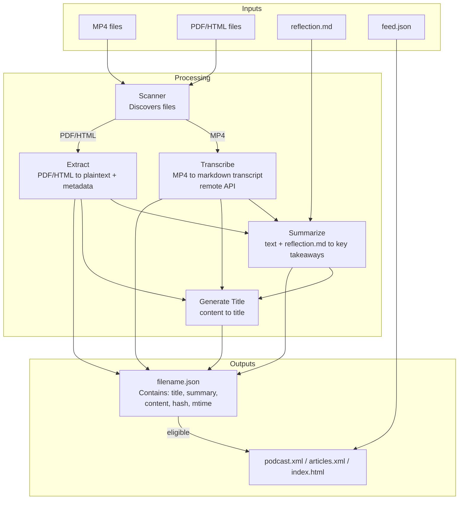

# Focus Feed

**Transform education content into RSS feeds with AI summarization powered by your reflection questions.**

## What It Does

Focus Feed turns your educational content (PDF, HTML, audio files) into private RSS feeds that you can consume in any podcast or RSS reader app.

To guide summaries toward your learning goals, create a `reflection.md` file containing a list of reflection questions in a folder. Focus Feed provides these questions to the AI when summarizing materials in that folder. The resulting summary appears in the feed item description.



## Quick Start

```bash
# Process supported files
uv run focus-feed process ./data

# Access your feeds at {BASE_URL}/index.html in your browser
```

## Environment Variables

Required configuration:
- BASE_URL - base URL for your feeds
- LLM_ENDPOINT - OpenAI-compatible API endpoint
- LLM_API_KEY - API key for the LLM service
- LLM_MODEL - model identifier for the LLM service
- PROMPT_ARTICLE - article summarization prompt
- PROMPT_PODCAST - podcast/audio summarization prompt
- PROMPT_TITLE - title generation prompt
- TRANSCRIPTION_ENDPOINT - transcription API endpoint
- TRANSCRIPTION_API_KEY - API key for transcription service

Optional:
- PROMPT_ARTICLE_REFLECTION - reflection-aware article prompt
- PROMPT_PODCAST_REFLECTION - reflection-aware podcast prompt
- TRANSCRIPTION_REMOTE_MODEL - transcription model override

## Processing Modes

### Batch Mode
Process all files at once in a directory.

### Incremental Mode
Watch for new or updated files:
```bash
uv run focus-feed watch ./data
```

## Granular Processing

Target specific steps or files:

- `transcribe` - Transcribe audio files to markdown (remote-only)
- `summarize` - Generate summaries from transcripts or document content
- `extract` - Extract metadata from PDF/HTML files
- `title` - Generate titles for files that lack proper titles
- `feeds` - Generate RSS feeds and index.html
- `validate` - Validate all metadata files
- `create-feed` - Create a template `feed.json` in a directory
- `cleanup` - Remove unknown keys from JSON metadata files

### Common Flags

- `--force` - Force re-processing even if complete or unchanged
- `--dry-run` - Preview without making changes (transcribe, summarize, extract)
- `--config-file <path>` - Use custom `.env` file

### Examples

```bash
# Process a single file
uv run focus-feed process ./videos/lecture.mp4

# Force re-transcription
uv run focus-feed transcribe ./videos/lecture.mp4 --force

# Summarize a PDF
uv run focus-feed summarize ./documents/report.pdf

# See what would be transcribed
uv run focus-feed transcribe --dry-run
```
