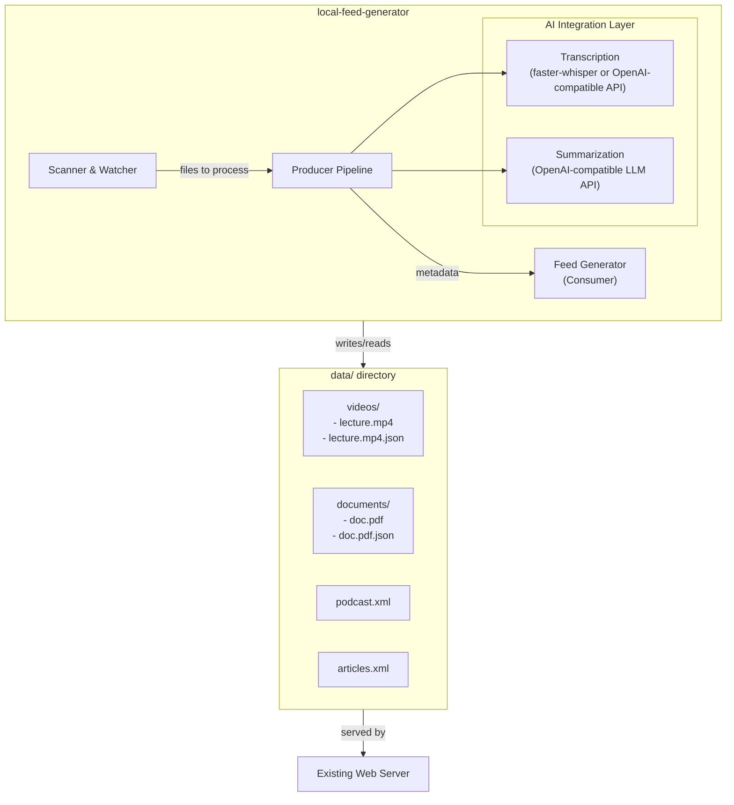
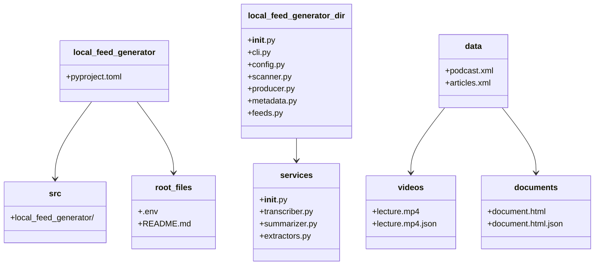
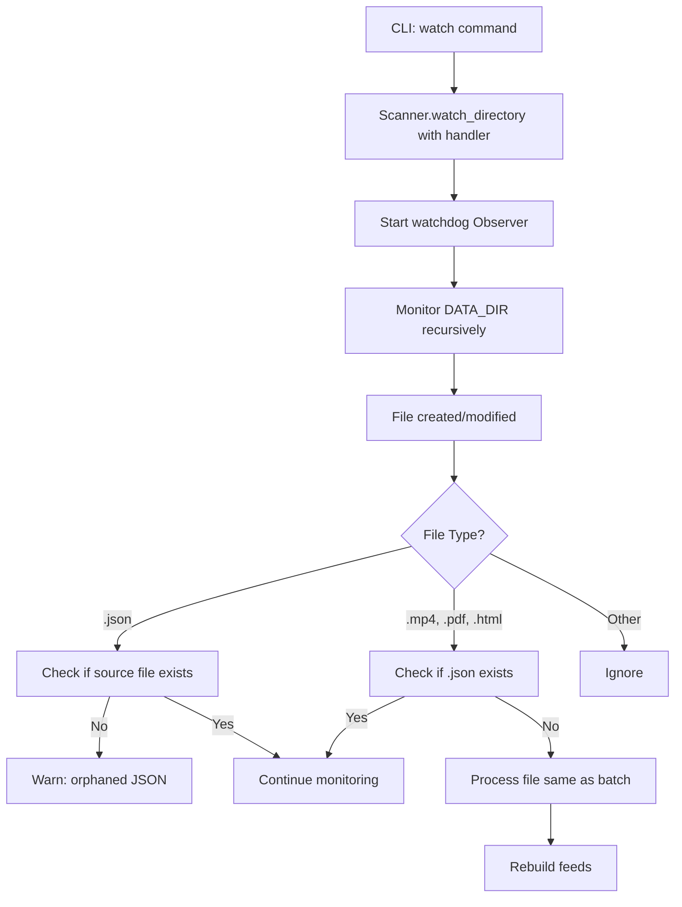

# Local Feed Generator - Design Document

**Application Name:** `local-feed-generator`

---

## 1. Overview

The `local-feed-generator` is a standalone application that processes content files (PDF, HTML, MP4) in a `data` directory and generates RSS/Atom feeds for personal consumption through mobile applications. The system supports both local and remote transcription: by default, it uses GPU-accelerated open-weight models (faster-whisper) for audio transcription; when configured with a remote endpoint via `TRANSCRIPTION_ENDPOINT`, it automatically uses an OpenAI-compatible API for transcription. Summarization always uses OpenAI-compatible local LLMs.

### 1.1 System Goals

- **Privacy-first:** All processing happens on local infrastructure (Nvidia GPU)
- **Minimal dependencies:** Uses open-weight models and standard libraries
- **Idempotent processing:** Skips files with existing metadata; processes only new/changed files
- **Mobile-ready:** Generates standard-compliant feeds consumable by Antennapod (podcast) and any RSS reader (articles)
- **Configurable:** System prompts, feed formats, and runtime parameters via environment variables

---

## 2. Architecture

### 2.1 System Boundaries



### 2.2 Major Components

- **Scanner & Watcher** (`watchdog`): Discovers files in `data/`; detects new/changed files; triggers processing
- **Producer Pipeline** (Python): Orchestrates file processing; manages queue; generates metadata
  - **Transcription Service** (`faster-whisper` + CUDA or OpenAI-compatible API): Converts MP4 audio to markdown text using either local (faster-whisper) or remote (OpenAI-compatible API) mode. The system implements a dual-mode architecture with the `RemoteTranscriber` class for API-based transcription and the local `Transcriber` class for GPU-accelerated transcription.
- **Summarization Service** (`openai` client → local LLM): Generates key takeaways from transcripts
- **Feed Generator** (`feedgen`): Aggregates metadata; generates RSS/Atom feeds
- **Configuration** (`pydantic-settings` + `.env`): Manages runtime settings
- **CLI** (`click`): Command-line interface

### 2.3 Data Flow

```mermaid
flowchart TD
    A[Scanner discovers file] --> B{*.json exists?}
    B -->|Yes| C[Skip - idempotent]
    B -->|No| D[Determine file type]

    D -->|MP4| E[Transcription Service\n(local or remote)]
    E --> F[markdown transcript]
    F --> G[Summarization Service]
    G --> H[key takeaways]

    D -->|PDF/HTML| I[Extract metadata]

    H --> J[Generate JSON metadata]
    I --> J
    J --> K[Write .json adjacent to source]

    K --> L[Feed Generator reads all valid *.json]
    L --> M[Generate podcast.xml & articles.xml]
    M --> N[Place feeds in data/ root]
```

---

## 3. Interfaces & Contracts

### 3.1 CLI Interface

```bash
# Process all files in data/ directory (batch mode)
uv run local-feed-generator process --data-dir ./data

# Process a single file
uv run local-feed-generator process --data-dir ./data --file videos/lecture.mp4

# Force reprocessing of a file
uv run local-feed-generator process --data-dir ./data --file videos/lecture.mp4 --force

# Watch data/ directory for changes (incremental mode)
uv run local-feed-generator watch --data-dir ./data

# Generate feeds only (no processing)
uv run local-feed-generator feeds --data-dir ./data

  # Validate all metadata files and finalize JSON
  uv run local-feed-generator validate --data-dir ./data

# Transcribe MP4 files to markdown text
uv run local-feed-generator transcribe --data-dir ./data

# Transcribe a specific file
uv run local-feed-generator transcribe --data-dir ./data --file videos/lecture.mp4

# Preview which files would be transcribed (no changes)
uv run local-feed-generator transcribe --data-dir ./data --dry-run

# Generate summaries from transcripts
uv run local-feed-generator summarize --data-dir ./data

# Extract metadata from PDF/HTML files
uv run local-feed-generator extract --data-dir ./data
```

#### Subcommands

- **`process`**: Process all files in data directory (batch mode)
- **`watch`**: Watch for changes and process incrementally
- **`feeds`**: Generate RSS/Atom feeds from existing JSON metadata; finalizes JSON by computing feed eligibility
- **`validate`**: Validate all metadata files and finalize incomplete ones by setting step completion statuses
- **`transcribe`**: Transcribe MP4 files using local or remote mode
- **`summarize`**: Generate summaries from existing transcripts
- **`extract`**: Extract metadata from PDF/HTML files

#### Flags

- **`--data-dir <path>`** (All commands): Path to the data directory. Defaults to `DATA_DIR` from configuration.
- **`--config-file <path>`** (All commands): Path to a `.env`-style configuration file.
- **`--file <path>`** (All commands): Process only the specified file instead of scanning the entire directory. Takes precedence over `--data-dir`.
- **`--force`** (All commands): Force execution even if the step appears already complete.
- **`--dry-run`** (transcribe, summarize, extract): Show which files would be processed without making any changes.

### 3.2 Environment Configuration

The application uses the following environment variables:

```bash
# Required
BASE_URL=https://example.com/feeds        # Root URL for feed enclosure links
DATA_DIR=./data                           # Path to data directory

# LLM Configuration
LLM_ENDPOINT=https://llm.example.com/v1
LLM_API_KEY=your-api-key-here
LLM_MODEL=mistralai/Mistral-7B-Instruct

# Feed Configuration
FEED_FORMAT=rss                           # rss or atom (default: rss)

# Transcription Configuration
TRANSCRIPTION_MODEL=large-v3-turbo
TRANSCRIPTION_DEVICE=cuda
TRANSCRIPTION_COMPUTE_TYPE=float16

# Remote Transcription Configuration (optional - enables remote mode when TRANSCRIPTION_ENDPOINT is set)
TRANSCRIPTION_ENDPOINT=https://api.example.com/v1/audio/transcriptions  # URL for remote transcription API
TRANSCRIPTION_API_KEY=your-api-key-here                              # API key for remote transcription endpoint
TRANSCRIPTION_REMOTE_MODEL=whisper-1                                  # Model override for remote endpoint (not passed by default)

# LLM System Prompt Configuration
LLM_SYSTEM_PROMPT="Summarize key takeaways from this document. Focus on frameworks or analytical tools to develop critical, creative, and systems thinking."
```

### 3.3 JSON Metadata Schema

Each processed file has a corresponding `.json` file with the same name in the same directory:

```json
{
  "version": "2.0",
  "title": "My Audio File",
  "description": "",
  "summary": "Key takeaways from LLM...",
  "content": "Full transcript...",
  "filename": "lecture.mp4",
  "filepath": "videos/lecture.mp4",
  "filetype": "mp4|pdf|html",
  "date": 1710000000,
  "duration": 45.5,
  "creation_time": "2024-01-01T00:00:00Z",
  "size": 12345678,
  
  "transcribe": {
    "status": null | "in_progress" | "complete",
    "start_time": 1710000000,
    "end_time": 1710000005,
    "input_size": 12345678,
    "output_size": 456789,
    "words": 452,
    "model": "large-v3-turbo",
    "input_tokens": null,
    "output_tokens": null
  },
  
  "summarize": {
    "status": null | "in_progress" | "complete",
    "start_time": 1710000005,
    "end_time": 1710000010,
    "input_size": 456789,
    "output_size": 1997,
    "words": 345,
    "model": "mistralai/Mistral-7B-Instruct",
    "input_tokens": 890,
    "output_tokens": 123
  },
  
  "extract": null | {
    "status": null | "in_progress" | "complete",
    "start_time": 1710000000,
    "end_time": 1710000005,
    "input_size": 12345678,
    "output_size": 456789,
    "model": "pypdf"
  },
  
  "feed_eligible": true | false,
  "error": "string (optional)"
}
```

**Field Descriptions:**
- `transcribe`, `summarize`, `extract`: Step maps tracking processing steps. Each contains a `status` field (null, "in_progress", "complete") and detailed timing/metrics. For MP4 files, `transcribe` and `summarize` are populated; for PDF/HTML files, `extract` is populated.
- `title`: Human-readable title (LLM-generated if not in source metadata). Underscores are automatically replaced with spaces.
- `description`: For MP4 files, this is blank. For PDF/HTML files, this contains extracted metadata.
- `summary`: For MP4 files, this contains LLM-generated key takeaways. For PDF/HTML files, this is null.
- `content`: For MP4 files, this contains the full transcript. For PDF/HTML files, this is null.
- `filepath`: Relative path from `data/` directory root
- `date`: Publication/creation date stored as UNIX epoch timestamp (integer seconds since 1970-01-01T00:00:00Z)
- `creation_time`: ISO8601 formatted creation timestamp
- `duration`: For MP4 files, duration in seconds (float). Not applicable for PDF/HTML files.
- `size`: File size in bytes (for podcast enclosure `length`)
- `error`: Optional; contains error message if any step failed
- `version`: Schema version identifier (currently "2.0")

**Note:** The absolute URL for feed enclosures is computed when generating feeds by combining `BASE_URL` + `filepath`.

**Feed Eligibility Rules:**
- **MP4 files**: `feed_eligible = (transcribe.status == "complete" AND summarize.status == "complete")`
- **PDF/HTML files**: `feed_eligible = (extract.status == "complete")`
- Items with `feed_eligible = false` are excluded from feeds

**Backwards Compatibility:** When loading JSON files with deprecated fields (`transcribe_status`, `summarize_status`, `extract_status`, `stage`, string `status`, `transcript`, `processing_date`, `completed_at`, `started_at`), a warning is printed to stderr. Deprecated fields are ignored (not migrated).

### 3.4 Feed Output

Two feed files are generated in the `data/` directory root:
- `podcast.xml` (or `podcast.atom`) - Contains all MP4 files with enclosures
- `articles.xml` (or `articles.atom`) - Contains all PDF/HTML files

For podcast feed items:
- Title from metadata
- Description from `summary` field (LLM-generated key takeaways)
- Enclosure: URL, type="audio/mp4", length (file size from `size` field)

For articles feed items:
- Title from metadata
- Description from `description` field (extracted metadata)

**Feed Item Sorting:** Folder name (ascending), then filename (ascending)

---

## 4. Technology Stack

### 4.1 Dependencies

- **`feedgen`**: RSS/Atom feed generation with podcast extension
- **`watchdog`**: File system monitoring for incremental mode
- **`faster-whisper`**: GPU-accelerated audio transcription
- **`openai`**: Client for OpenAI-compatible LLM API and remote transcription API
- **`pydantic-settings`**: Configuration management with environment variables
- **`pydantic`**: Data validation for metadata
- **`click`**: CLI interface
- **`pypdf`**: PDF metadata extraction (title, author)
- **`beautifulsoup4`**: HTML metadata extraction (title from `<title>` tag)

#### 4.1.1 AV Library Compatibility Issue

**Issue:** `faster-whisper` passes `metadata_errors="ignore"` to `av.open()`, but a newer `av` release removed this parameter.

**Error:** `TypeError: av.open() got an unexpected keyword argument 'metadata_errors'`

**Root Cause:** Breaking change in `av` library between releases.

**Context:** `faster-whisper` uses CTranslate2 which handles audio decoding through the `av` library. The parameter `metadata_errors` was valid in an earlier release but was removed in a later release.

**Fix Applied:** Pinned `av` in `pyproject.toml` dependencies to prevent installation of incompatible releases.

**Recommendation:** Pin `av` in production deployments. Users should be aware of this dependency conflict when managing their environments.

**Future Consideration:** Monitor `faster-whisper` updates that may resolve this compatibility issue with newer `av` releases.

### 4.2 Transcription Engine Selection

**Dual-Mode Support:** The transcription system supports both local and remote modes. When `TRANSCRIPTION_ENDPOINT` is configured, the system automatically switches to remote transcription mode and uses the OpenAI-compatible API for all transcription tasks. When `TRANSCRIPTION_ENDPOINT` is not configured, the system defaults to local transcription using `faster-whisper`.

**Recommendation (Local Mode):** `faster-whisper` with `large-v3-turbo` model on CUDA with float16

#### Mode Selection Logic

- **Remote Mode**: Enabled when `TRANSCRIPTION_ENDPOINT` is set. Uses OpenAI-compatible API for transcription via the `RemoteTranscriber` class which implements `transcribe()` method that uploads audio files to the remote endpoint and retrieves the transcript.
- **Local Mode**: Used when `TRANSCRIPTION_ENDPOINT` is not configured. Uses `faster-whisper` with GPU acceleration.
- **Model Override**: The `TRANSCRIPTION_REMOTE_MODEL` variable is optional and not passed to the remote endpoint by default. When specified, it overrides the default model selection on the remote endpoint.

#### Fallback Behavior

- **Remote Mode Priority**: When `TRANSCRIPTION_ENDPOINT` is configured, remote mode becomes the default and is used exclusively. The system does **not** automatically fall back to local transcription if the remote endpoint fails.
- **Error Handling**: If remote transcription fails (connection errors, API errors, authentication errors, or audio duration limits reached), the error is captured and recorded in the JSON metadata. The file processing is marked as failed and excluded from feeds.
- **Manual Fallback**: To switch from remote to local mode, the user must unset or remove the `TRANSCRIPTION_ENDPOINT` configuration and reprocess the affected files.

#### Remote Mode Configuration Requirements

When using remote transcription mode, the following server-side configuration must be in place:

- **OpenAI-Compatible API**: The remote endpoint must implement the OpenAI audio transcription API format (POST to `/v1/audio/transcriptions` with audio file upload)
- **Authentication**: The endpoint must accept the API key provided in `TRANSCRIPTION_API_KEY`
- **vLLM Server Configuration**: If using vLLM as the remote transcription endpoint, the server requires `VLLM_MAX_AUDIO_DECODE_DURATION_S` environment variable to be set to a value (in seconds) that accommodates the longest audio files. For example: `VLLM_MAX_AUDIO_DECODE_DURATION_S=3600` allows for 1-hour audio files. Without this configuration, the server may reject longer audio files with "Audio exceeds maximum allowed duration" errors.
- **Model Support**: The remote endpoint must support the transcription model being used (default or specified via `TRANSCRIPTION_REMOTE_MODEL`)

#### RemoteTranscriber Class Implementation Details

The `RemoteTranscriber` class is implemented in `src/local_feed_generator/services/transcriber.py` and provides:

- **API Client**: Uses the OpenAI Python SDK client configured with the remote endpoint URL and API key
- **Audio Upload**: Sends `multipart/form-data` requests with the audio file and optional model parameter
- **Configuration Integration**: Reads from `TRANSCRIPTION_ENDPOINT`, `TRANSCRIPTION_API_KEY`, and `TRANSCRIPTION_REMOTE_MODEL` environment variables
- **Error Handling**: Catches and propagates API errors (connection errors, HTTP errors, authentication errors, rate limiting, and audio duration limits)
- **Response Parsing**: Extracts the transcript text from the OpenAI-compatible API response format. The client handles both plain text and JSON response formats; **note that vLLM servers return JSON even with `response_format="text"`**, so the client extracts the text field from the JSON response.

#### Why faster-whisper? (Local Mode)

Given that **GPU support is critical** and **RAM is not a limitation**, with **best transcription quality as the top priority**, **faster-whisper** is the optimal choice for local transcription.

**faster-whisper** is a reimplementation of OpenAI's Whisper model using [CTranslate2](https://github.com/OpenNMT/CTranslate2/), offering:

- **2-4x faster** than original PyTorch Whisper at same accuracy
- **Full CUDA support** for Nvidia GPUs
- **Float16 precision** for highest quality without quantization
- **Python-native API** for seamless integration
- **Batch processing** support for efficient file handling
- **Accurate parity** with original Whisper models

#### Transcription Quality Comparison

| Model | Size | Accuracy | Speed (GPU) | Language Support |
|-------|------|----------|-------------|------------------|
| `tiny` | 39M | Basic | Fastest | Multilingual |
| `base` | 74M | Good | Fast | Multilingual |
| `small` | 244M | Very Good | Moderate | Multilingual |
| `medium` | 769M | Excellent | Moderate | Multilingual |
| **`large-v3-turbo`** | **~800M** | **Best** | **Good** | **Multilingual** |
| `large-v3` | 1550M | Best (slower) | Good | Multilingual |

**For this project (Local Mode):** Use `large-v3-turbo` with CUDA + float16 for maximum transcription quality.

**Remote Mode Considerations:** When using remote transcription, ensure the endpoint is compatible with OpenAI's audio transcription API format. The remote endpoint determines the default model unless `TRANSCRIPTION_REMOTE_MODEL` is explicitly configured.

### 4.3 Summarization Model

**Recommendation:** Any OpenAI-compatible model with 128K+ context window
- **API:** OpenAI-compatible endpoint (as specified in `LLM_ENDPOINT`)
- **System Prompt:** Configurable via `LLM_SYSTEM_PROMPT` environment variable

---

## 5. Directory Structure



**Project Layout:**
```
local-feed-generator/
├── pyproject.toml
├── src/local_feed_generator/
│   ├── __init__.py
│   ├── cli.py
│   ├── config.py
│   ├── scanner.py
│   ├── producer.py
│   ├── services/
│   │   ├── __init__.py
│   │   ├── transcriber.py
│   │   ├── summarizer.py
│   │   └── extractors.py
│   ├── metadata.py
│   └── feeds.py
├── .env
└── README.md

data/
├── podcast.xml
├── articles.xml
├── videos/
│   ├── lecture.mp4
│   ├── lecture.mp4.json
│   └── notes.pdf
└── documents/
    ├── document.html
    └── document.html.json
```

### 5.2 Module Responsibilities

#### Scanner
- Discovers all MP4, PDF, HTML files in the data directory
- Batch mode: Returns list of files without corresponding JSON metadata
- Incremental mode: Watches for file system changes and triggers processing
- Validates filenames for special characters (warnings only)
- Detects orphaned JSON files (JSON without source file)

#### Producer
- Orchestrates file processing based on file type
- For MP4 files: Requests transcription, then summarization
- For PDF/HTML files: Extracts metadata, uses LLM for title if needed
- Generates JSON metadata file adjacent to source file
- Handles errors gracefully, writing error state to JSON

#### Transcription Service
- Converts MP4 audio to markdown text
- Uses faster-whisper with CUDA GPU acceleration for highest quality
- No timestamps in output (clean transcript only)
- Tracks processing in the `transcribe` step map

#### Summarization Service
- Generates key takeaways from audio transcripts
- Uses configured OpenAI-compatible LLM endpoint
- Can generate titles when source metadata is unavailable
- Tracks processing in the `summarize` step map

#### Extractors Service
- Extracts metadata from PDF files using PyPDF
- Extracts metadata from HTML files using BeautifulSoup
- Generates titles from content using LLM if metadata unavailable
- Tracks processing in the `extract` step map

#### Feed Generator
- Reads all JSON metadata files from data directory
- Filters entries by feed_eligible computed property (which checks the step map status values)
- For MP4: Uses `summary` field for feed item descriptions
- For PDF/HTML: Uses `description` field for feed item descriptions
- Generates podcast feed for MP4 files with enclosures
- Generates articles feed for PDF/HTML files
- Sorts items by folder name, then filename
- Writes feeds to data directory root

---

## 6. Data Flow Details

### 6.1 Batch Processing Flow

Audio files (MP4) are transcribed using either local (faster-whisper) or remote (OpenAI-compatible API) transcription based on the configuration. When `TRANSCRIPTION_ENDPOINT` is set, remote mode is used; otherwise, local mode with faster-whisper is used.

```mermaid
flowchart TD
    A[CLI: process command] --> B[Scanner.scan_directory]
    B -->|Recursively walks DATA_DIR| C[Finds .mp4, .pdf, .html]
    C --> D[Filters out files with .json]
    D --> E[Returns list of files]

    E --> F[For each file: Producer.process_file]
    F --> G{File Type?}

     G -->|MP4| H1[Transcribe to markdown\n(local or remote)]
     H1 --> I1[Store transcript in content field]
     I1 --> J1[Summarize transcript]
     J1 --> K1[Store summary in summary field]
     K1 --> L1[Set description to blank]
     L1 --> M1[Extract/Generate title]

    G -->|PDF| H2[Extract title from metadata]
    H2 -->|No title| J2[Generate title via LLM]
    H2 --> K2[Store metadata in description field]
    K2 --> L2[Set summary and content to null]

    G -->|HTML| H3[Extract title from HTML]
    H3 -->|No title| J3[Generate title via LLM]
    H3 --> K3[Store metadata in description field]
    K3 --> L3[Set summary and content to null]

    M1 --> N[Generate JSON metadata with step maps]
    L2 --> N
    L3 --> N

    N --> O[Write .json file]

    F -->|Error| P[Write error state to .json]

    O --> Q[Feed Generator rebuilds feeds]
    P --> Q
    Q --> R[podcast.xml & articles.xml updated]
```

### 6.2 Incremental Processing Flow

Incremental processing uses the same transcription mode selection as batch processing. MP4 files are transcribed either locally via faster-whisper or remotely via OpenAI-compatible API, depending on the `TRANSCRIPTION_ENDPOINT` configuration.



---

## 7. Error Handling

### 7.1 Processing Errors

When an error occurs during processing:
1. Catch the exception
2. Create metadata with appropriate error message
3. Write `.json` file to disk
4. **Exclude from feeds** (filter by feed_eligible computed property)
5. Log error to stderr

### 7.2 Special Characters in Filenames

- Scanner validates filenames during scan
- Warnings are logged (not errors)
- Filenames are **not modified**
- Feed generator properly escapes XML special characters

### 7.3 Orphaned JSON Files

- Detected during watch mode or validation
- Warning logged during processing
- Orphaned JSON files are **ignored** during feed generation
- User must manually clean up

### 7.4 Model Inference Failures

**Transcription Failures (Local Mode):**
- Corrupted audio file: Mark as error, continue with other files
- GPU errors: Verify CUDA setup and retry

**Transcription Failures (Remote Mode):**
- Connection errors: Mark as error, log details, continue with other files
- Authentication errors: Verify `TRANSCRIPTION_API_KEY`, mark as error
- Rate limiting: Respect retry-after header if provided, otherwise mark as error
- API errors: Capture error message from response, mark as error

**LLM Failures:**
- API connection error: Retry with exponential backoff
- Rate limiting: Respect retry-after header
- Context overflow: Should not occur (128k context model used)

---

## 8. Security Considerations

### 8.1 Data Privacy

- All processing is local by default
- When using local transcription mode (default), no audio data leaves the local infrastructure
- When using remote transcription mode (`TRANSCRIPTION_ENDPOINT` configured), audio files are uploaded to the remote transcription API endpoint
- LLM endpoint is internal (as configured)
- **Recommendation:** Use local transcription mode for maximum privacy. Only use remote mode with trusted endpoints.

### 8.2 Input Validation

- File paths are validated before processing
- Only `.mp4`, `.pdf`, `.html` extensions are processed
- Filenames with special characters generate warnings but are processed

### 8.3 XML Injection

- `feedgen` library properly escapes all XML content
- No manual string concatenation for XML generation

---

## 9. Performance Considerations

### 9.1 GPU Utilization

- `faster-whisper` with CUDA provides optimal transcription performance
- Model loaded once and reused for all files
- Batch processing sequential to ensure stable GPU utilization

### 9.2 Processing Characteristics

- PDF/HTML processing is lightweight and CPU-bound
- MP4 transcription is GPU-accelerated
- LLM summarization happens on separate infrastructure (via API)
- Feed generation is fast (reading JSON and writing XML)

---

## 10. Configuration Recommendations

### 10.1 Feed Format

**Recommendation:** Use **RSS** (`FEED_FORMAT=rss`)

**Rationale:**
- Better podcast support (enclosure tags well-defined)
- More widely supported by podcast apps (including Antennapod)
- Simpler than Atom for this use case
- `feedgen` has excellent podcast extension support for RSS

### 10.2 Transcription Model

**Recommendation:** `large-v3-turbo` with CUDA + float16

**Configuration:**
```
TRANSCRIPTION_MODEL=large-v3-turbo
TRANSCRIPTION_DEVICE=cuda
TRANSCRIPTION_COMPUTE_TYPE=float16
```

**Note:** No quantization needed for best quality. Use float16 for maximum transcription accuracy.

### 10.2.1 Transcription Mode Selection

**Recommendation:** Use **local mode** (faster-whisper) for most deployments

**Local Mode (Default):**
- **When to use:** When privacy is critical, GPU is available, or network connectivity is unreliable
- **Configuration:** Do not set `TRANSCRIPTION_ENDPOINT` (or leave it blank)
- **Advantages:** Full privacy, no network dependency, GPU-accelerated, one-time model download
- **Disadvantages:** Requires Nvidia GPU with CUDA, initial model download (~2-6 GB)

**Remote Mode:**
- **When to use:** When GPU is not available, or when using a managed transcription service
- **Configuration:** Set `TRANSCRIPTION_ENDPOINT` to your OpenAI-compatible API endpoint
- **Advantages:** No GPU requirement, no local model storage
- **Disadvantages:** Audio files are uploaded to remote endpoint, network dependency, potential costs
- **Optional Model Override:** Use `TRANSCRIPTION_REMOTE_MODEL` only if the remote endpoint requires a specific model parameter

### 10.3 LLM System Prompt

**Recommendation:**
```
LLM_SYSTEM_PROMPT="Summarize key takeaways from this document. Focus on frameworks or analytical tools to develop critical, creative, and systems thinking."
```

---

## 11. Implementation Milestones

### Milestone 1: Foundation
- [ ] Set up project with dependency management
- [ ] Implement configuration system
- [ ] Implement JSON metadata schema and validation
- [ ] Set up CLI framework
- [ ] Create basic directory structure

### Milestone 2: Scanner & File Processing
- [ ] Implement scanner with batch processing
- [ ] Implement producer with file type dispatch
- [ ] Add PDF metadata extraction
- [ ] Add HTML metadata extraction
- [ ] Add title generation fallback (LLM-based)
- [ ] Test with sample PDF/HTML files

### Milestone 3: Audio Processing
- [ ] Implement transcription service
- [ ] Implement summarization service
- [ ] Integrate transcription into producer
- [ ] Integrate summarization into producer
- [ ] Test with sample MP4 files

### Milestone 4: Feed Generation
- [ ] Implement feed generator
- [ ] Generate podcast feed with enclosures
- [ ] Generate articles feed
- [ ] Implement proper XML escaping
- [ ] Implement sorting by filepath

### Milestone 5: Incremental Mode & Polish
- [ ] Implement watch mode with file system monitoring
- [ ] Add error handling and status tracking
- [ ] Add filename validation warnings
- [ ] Add orphaned JSON detection
- [ ] Add validation command
- [ ] Final integration testing

### Milestone 6: Documentation & Deployment
- [ ] Write user documentation
- [ ] Document environment setup
- [ ] Document model installation requirements
- [ ] Final end-to-end testing
- [ ] Create example `data/` directory with sample files

---

## 12. Assumptions & Dependencies

### 12.1 External Dependencies

1. **Nvidia GPU with CUDA:** Required for efficient transcription
2. **CUDA Toolkit:** Must be installed and configured
3. **Local LLM Endpoint:** Must be running and accessible (as per `.env`)
4. **Python:** For modern language features
5. **uv:** For dependency management

### 12.2 Model Requirements

- `faster-whisper` models will be downloaded on first run (or pre-downloaded)
- Models are stored in `~/.cache/huggingface/hub/` by default
- First run for audio will download the transcription model (~2-6 GB depending on size)

---

## 13. Decisions

### 13.1 Title Generation

**Decision:** Use LLM to generate titles for all files unless source provides one.

**Rationale:**
- PDF/HTML may have metadata titles
- If not available, LLM can generate better titles than filenames
- Consistent user experience across all file types

### 13.2 Feed Regeneration

**Decision:** Regenerate feeds after every file processing (both batch and incremental).

**Rationale:**
- Ensures feeds are always up-to-date
- Simple to implement
- Performance impact is minimal

### 13.3 Error Recovery

**Decision:** Error state is persistent in JSON; user must fix source file and delete JSON to retry.

**Rationale:**
- Prevents infinite retry loops
- Clear error state visible to user
- Manual intervention ensures user awareness

---

## 14. Risks & Mitigations

| Risk | Likelihood | Impact | Mitigation |
|------|------------|--------|------------|
| R-001: Transcription quality | Medium | Medium | Use well-established models; accept basic quality for personal use |
| R-002: LLM summarization inconsistency | Medium | Low | Use tested system prompt; allow config updates |
| R-003: File watcher misses events | Low | Medium | Implement periodic directory scanning as fallback |
| R-004: Special characters in filenames | Low | Low | Proper XML escaping; warnings during processing |
| R-005: Large audio files slow | Low | Low | Acceptable for personal use; no time constraints |
| R-006: GPU memory exhaustion | Low | High | Use float16 or int8; fallback to smaller models |
| R-007: LLM API unavailable | Low | Medium | Clear error messages; retry logic |

---

## 15. Appendix

### 15.1 Glossary

- **RSS:** Really Simple Syndication - web feed format
- **Atom:** Alternative web feed format
- **MP4:** Audio/video file format
- **PDF:** Portable Document Format
- **HTML:** HyperText Markup Language
- **CUDA:** Nvidia's parallel computing platform
- **LLM:** Large Language Model

### 15.2 References

- [python-feedgen](https://github.com/lkiesow/python-feedgen)
- [watchdog](https://github.com/gorakhargosh/watchdog)
- [faster-whisper](https://github.com/guillaumekln/faster-whisper)
- [openai-python](https://github.com/openai/openai-python)
- [pydantic](https://pydantic.dev/)
- [PyPDF2](https://pypdf.readthedocs.io/)
- [BeautifulSoup](https://www.crummy.com/software/BeautifulSoup/)
