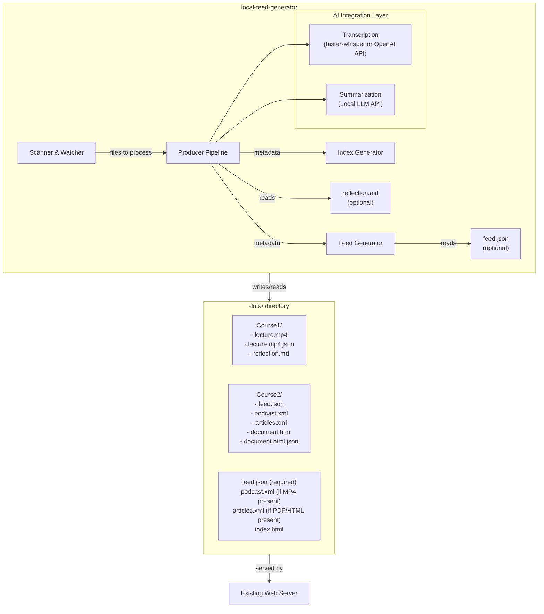
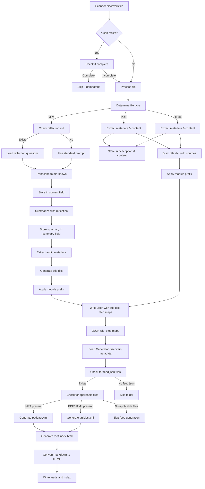

# Local Feed Generator - Design Document

**Application Name:** `local-feed-generator`

---

## 1. Overview

The `local-feed-generator` is a standalone application that processes content files (PDF, HTML, MP4) in a `data` directory and generates RSS feeds for personal consumption. It supports both local and remote transcription: by default, it uses GPU-accelerated faster-whisper for audio transcription; when configured with `TRANSCRIPTION_ENDPOINT`, it uses an OpenAI-compatible API. Summarization uses OpenAI-compatible local LLMs.

### 1.1 System Goals

- **Privacy-first:** All processing happens on local infrastructure (Nvidia GPU)
- **Minimal dependencies:** Uses open-weight models and standard libraries
- **Idempotent processing:** Skips files with existing complete metadata
- **Mobile-ready:** Generates standard-compliant RSS feeds consumable by podcast apps and RSS readers
- **Configurable:** System prompts, feed formats, and runtime parameters via environment variables
- **Flexible organization:** Supports per-folder feed generation with custom titles and descriptions
- **Conditional feeds:** Feeds are only generated where `feed.json` exists and applicable files are present
- **Root index page:** Auto-generates root-level `index.html` for feed discovery

---

## 2. Architecture

### 2.1 System Boundaries



**Note:** Root-level feeds are ONLY generated if `feed.json` exists in the root and applicable files are present.

### 2.2 Major Components

- **Scanner & Watcher** (`watchdog`): Discovers files in `data/`; detects new/changed files; triggers processing; implements debouncing and periodic rescan
- **Producer Pipeline** (Python): Orchestrates file processing; manages queue; generates metadata with step tracking
  - **Transcription Service:** Converts MP4 audio to markdown text using either local faster-whisper (CUDA) or remote OpenAI-compatible API
  - **Summarization Service:** Generates key takeaways using local LLM endpoint; supports reflection questions from `reflection.md`
  - **Extraction Service:** Extracts metadata AND content from PDF/HTML files (`pypdf`, `beautifulsoup4`); extracts audio metadata via `av` library
- **Feed Generator** (`feedgen`): Aggregates metadata; generates RSS podcast/article feeds; only generates feeds where `feed.json` exists and applicable files are present
- **Index Generator:** Generates root-level `index.html` listing all available feeds
- **Configuration** (`pydantic-settings` + `.env`): Manages runtime settings
- **CLI** (`click`): Command-line interface with granular subcommands

### 2.3 Data Flow



---

## 3. Interfaces & Contracts

### 3.1 CLI Interface

**Main Commands:**
- `process` - Process all files in data directory (batch mode)
- `watch` - Watch for changes and process incrementally
- `feeds` - Generate RSS feeds from existing JSON metadata
- `validate` - Validate all metadata files and finalize incomplete ones
- `transcribe` - Transcribe MP4 files to markdown text
- `summarize` - Generate summaries from transcripts or extracted content
- `extract` - Extract metadata and content from PDF/HTML files
- `create-feed` - Create a template `feed.json` file in a directory

**Common Flags:**
- `--data-dir <path>` - Path to data directory (defaults to `DATA_DIR`)
- `--config-file <path>` - Path to `.env`-style configuration file
- `--file <path>` - Process only specified file
- `--force` - Force execution even if step appears complete
- `--dry-run` - Preview files without making changes

### 3.2 Environment Configuration

**Required:**
```bash
BASE_URL=https://example.com/feeds        # Root URL for feed enclosure links
DATA_DIR=./data                           # Path to data directory
LLM_ENDPOINT=https://llm.example.com/v1
LLM_API_KEY=your-api-key-here
LLM_MODEL=mistralai/Mistral-7B-Instruct
PROMPT_ARTICLE="Summarize key takeaways..."
PROMPT_PODCAST="Summarize key takeaways..."
PROMPT_TITLE="Generate a concise, descriptive title..."
```

**Transcription (Local Mode - Default):**
```bash
TRANSCRIPTION_MODEL=large-v3-turbo
TRANSCRIPTION_DEVICE=cuda
TRANSCRIPTION_COMPUTE_TYPE=float16
```

**Transcription (Remote Mode - Optional):**
```bash
TRANSCRIPTION_ENDPOINT=https://api.example.com/v1/audio/transcriptions
TRANSCRIPTION_API_KEY=your-api-key-here
TRANSCRIPTION_REMOTE_MODEL=whisper-1
```

### 3.3 JSON Metadata Schema

Each processed file has a corresponding `.json` file with:

```json
{
  "title": {
    "filename": "lecture",           // sanitized filename (no extension, no underscores)
    "extracted": "Lecture 1",        // from source metadata
    "generated": "LLM Generated Title"  // LLM-generated with prompt
  },
  "extracted_title": "Lecture 1",   // source metadata title
  "description": "Extracted metadata description",
  "summary": "LLM-generated key takeaways",
  "content": "Full transcript or extracted text",
  "filename": "lecture.mp4",
  "filepath": "Course1/lecture.mp4",
  "filetype": "mp4|pdf|html",
  "date": 1728931200.123,            // UNIX epoch (float, ms precision)
  "publication_date": 1728931200.0,  // UNIX epoch (optional)
  "duration": 3600.5,                // MP4: duration in seconds
  "creation_time": "2024-01-15T10:30:00Z",  // ISO-8601 (MP4 only)
  "size": 12345678,
  "transcribe": {"status": null | "in_progress" | "complete", ...},
  "summarize": {"status": null | "in_progress" | "complete", ...},
  "extract": {"status": null | "in_progress" | "complete", ...},
  "error": "string (optional)"
}
```

**Title Precedence:** filename < extracted < generated (highest)

**Feed Eligibility Rules:**
- **MP4 files:** `feed_eligible = (transcribe.status == "complete" AND summarize.status == "complete")`
- **PDF/HTML files:** `feed_eligible = (extract.status == "complete")`

### 3.4 Feed Output

- `podcast.xml` - Contains all MP4 files with enclosures (only if feed.json exists AND MP4 files present)
- `articles.xml` - Contains all PDF/HTML files (only if feed.json exists AND PDF/HTML files present)
- `index.html` - Root-level page listing all available feeds

**Feed Item Format:**
- Title from computed title dict (precedence: generated > extracted > filename)
- Description from `summary` field (MP4) or `summary`/`description` field (PDF/HTML)
- MP4: Enclosure with URL, type="audio/mp4", length from `size` field
- Publication date from `publication_date` (PDF/HTML) or `date` (MP4)
- Markdown descriptions converted to HTML with XSS protection
- Sorted by folder name, then filename

### 3.5 Per-Folder Feed Configuration (feed.json)

Feeds are ONLY generated in folders containing `feed.json`:

```json
{
  "title": "Course 1: Introduction to AI",
  "description": "All materials for Course 1",
  "language": "en-us",
  "author": "Course Author",
  "link": "https://example.com/course1",
  "image": {
    "url": "https://example.com/logo.png",
    "title": "Course Logo",
    "link": "https://example.com/course1"
  }
}
```

**Key Rules:**
- Channel link defaults to `BASE_URL` + relative path when `link` field is not provided
- `link` field acts as an optional override for the channel link
- Each feed aggregates content from its entire directory subtree

### 3.6 Reflection Questions (reflection.md) - Optional

When a `reflection.md` file exists in a folder, its content is used as reflection questions for summarization:

```markdown
# Reflection Questions

1. What are the key frameworks or mental models presented?
2. What analytical tools can help develop critical thinking?
```

- Works with MP4, PDF, and HTML files
- Uses filetype-based reflection prompts: `PROMPT_PODCAST_REFLECTION` (MP4) or `PROMPT_ARTICLE_REFLECTION` (PDF/HTML)
- Falls back to standard prompts if `reflection.md` is not present

### 3.7 Index.html Generation

- Generated at root level if `feed.json` exists
- Contains links to all feeds that actually exist
- Includes feed titles and descriptions from each `feed.json`
- Single root-level page only (no per-folder index.html files)

---

## 4. Technology Stack

### 4.1 Dependencies

**Required:**
- `feedgen` - RSS feed generation
- `watchdog` - File system monitoring
- `openai` - LLM API client and remote transcription
- `pydantic-settings` + `pydantic` - Configuration and data validation
- `click` - CLI interface
- `pypdf` - PDF metadata and content extraction
- `beautifulsoup4` - HTML metadata and content extraction
- `av` (PyAV) - Audio metadata extraction
- `python-dotenv` - .env file loading

**Optional:**
- `faster-whisper` - Local GPU-accelerated transcription
- `markdown` - Enhanced markdown to HTML conversion
- `ffprobe` - CLI tool for audio metadata (fallback)

### 4.2 Transcription Engine

**Dual-Mode Support:**
- **Local Mode (Default):** Uses faster-whisper with CUDA GPU acceleration
  - Model: `large-v3-turbo` with float16 for best quality
  - 2-4x faster than original PyTorch Whisper
  - Full CUDA support, Python-native API
- **Remote Mode:** Uses OpenAI-compatible API when `TRANSCRIPTION_ENDPOINT` is configured
  - Uses `RemoteTranscriber` class
  - No automatic fallback to local mode if remote fails
  - Requires server-side: OpenAI-compatible endpoint, authentication, `VLLM_MAX_AUDIO_DECODE_DURATION_S` for long audio files

**Model Comparison for Local Mode:**
| Model | Size | Accuracy | Speed | Note |
|-------|------|----------|-------|------|
| `large-v3-turbo` | ~800M | Best | Good | **Recommended** |

### 4.3 Summarization Model

- **API:** OpenAI-compatible endpoint (`LLM_ENDPOINT`)
- **Context Window:** 128K+ recommended
- **Prompt Selection:**
  - MP4: `PROMPT_PODCAST` (or `PROMPT_PODCAST_REFLECTION` with reflection.md)
  - PDF/HTML: `PROMPT_ARTICLE` (or `PROMPT_ARTICLE_REFLECTION` with reflection.md)
  - Title: Always uses `PROMPT_TITLE`

### 4.4 Content Extraction

- **PDF:** `pypdf` - Extracts metadata (title, author, date) and full plaintext content
- **HTML:** `beautifulsoup4` - Extracts metadata (title tag, meta description, date) and body text
- **Audio:** `av` library - Extracts duration, creation_time, bit_rate, format; falls back to file modification time
- **Control Characters:** Automatically removed from extracted content for XML safety

---

## 5. Directory Structure

```
local-feed-generator/
├── pyproject.toml
├── .env
├── README.md
└── src/local_feed_generator/
    ├── __init__.py
    ├── cli.py
    ├── config.py
    ├── scanner.py
    ├── producer.py
    ├── metadata.py
    ├── feeds.py
    └── services/
        ├── __init__.py
        ├── transcriber.py
        ├── remote_transcriber.py
        ├── summarizer.py
        └── extractors.py

data/
├── feed.json                    # REQUIRED for root feeds
├── podcast.xml                  # Generated only if MP4 files present
├── articles.xml                 # Generated only if PDF/HTML files present
├── index.html                   # Root-level feed index
└── Course1/
    ├── feed.json               # REQUIRED for per-folder feeds
    ├── podcast.xml             # Generated only if MP4 files present
    ├── articles.xml            # Generated only if PDF/HTML files present
    ├── lecture.mp4
    ├── lecture.mp4.json
    ├── reflection.md           # Optional
    └── notes.pdf
        └── notes.pdf.json
```

---

## 6. Key Architectural Decisions

### 6.1 Title as Dict with Source Tracking

**Decision:** Represent title as a dict with `filename`, `extracted`, and `generated` sources.
**Rationale:** Enables proper fallback logic (filename < extracted < generated), tracks title provenance, allows displaying original extracted title separately.

### 6.2 LLM-Based Title Generation

**Decision:** Use LLM to generate titles with prompt including sanitized filename and extracted title.
**Rationale:** MP4 files rarely have useful metadata; LLM combines filename, extracted title, and content for optimal results.

### 6.3 Module Name Prefixing

**Decision:** Automatically prepend parent folder name to final title (after precedence resolution).
**Rationale:** Better organization in feed readers, clearer context, automatic categorization.

### 6.4 Feed Regeneration Strategy

**Decision:** Regenerate feeds and index.html after every file processing.
**Rationale:** Ensures feeds are always up-to-date, simple implementation, minimal performance impact.

### 6.5 Error Recovery

**Decision:** Error state is persistent in JSON; user must fix source and delete JSON or use `--force` to retry.
**Rationale:** Prevents infinite retry loops, clear error state, manual intervention ensures awareness.

### 6.6 Content Extraction for PDF/HTML

**Decision:** Extract full plaintext content, not just metadata.
**Rationale:** Enables richer feed descriptions, future search/indexing features, minimal overhead.

### 6.7 Markdown to HTML Conversion

**Decision:** Convert markdown in feed descriptions to HTML with built-in fallback.
**Rationale:** Better rendering in feed readers, compatibility without markdown library, XSS protection.

### 6.8 Per-Folder Feeds

**Decision:** Support per-folder feed generation via `feed.json` files.
**Rationale:** Better organization for multiple courses, custom branding per folder, backward compatible.

### 6.9 Reflection Questions Support

**Decision:** Support optional `reflection.md` files for focused summarization.
**Rationale:** Educational use case, customizable per course, optional feature, uses separate prompts.

### 6.10 Millisecond Precision Timestamps

**Decision:** Store timestamps as UNIX epoch floats with millisecond precision.
**Rationale:** Better precision for tracking, minimal storage overhead, backward compatible.

### 6.11 Conditional Feed Generation

**Decision:** Only generate feeds where `feed.json` exists AND applicable file types are present.
**Rationale:** Explicit configuration, resource efficiency, clear intent, predictable behavior.

### 6.12 No Root Feeds Without feed.json

**Decision:** Root-level feeds require explicit `feed.json` configuration.
**Rationale:** Prevents accidental generation, encourages deliberate organization, consistent behavior.

### 6.13 Index.html Generation

**Decision:** Auto-generate root-level `index.html` listing all feeds.
**Rationale:** Easy feed discovery, human-readable directory structure, self-documenting organization.

---

## 7. Risks & Mitigations

| Risk | Likelihood | Impact | Mitigation |
|------|------------|--------|------------|
| Transcription quality | Medium | Medium | Use well-established models |
| LLM summarization inconsistency | Medium | Low | Use tested system prompts |
| File watcher misses events | Low | Medium | Periodic directory scanning fallback |
| Special characters in filenames | Low | Low | Proper XML escaping, warnings |
| Large audio files slow | Low | Low | Acceptable for personal use |
| GPU memory exhaustion | Low | High | Use float16, fallback to smaller models |
| LLM API unavailable | Low | Medium | Clear error messages, retry logic |
| Control characters in PDF/HTML | Medium | Medium | Automatically remove during extraction |
| XML generation failures | Low | Medium | Validate content, proper escaping |
| Missing feeds due to no feed.json | Medium | Medium | Document requirement clearly |

---

## 8. Assumptions & Dependencies

### 8.1 External Dependencies

1. **Nvidia GPU with CUDA** - Required for efficient local transcription
2. **CUDA Toolkit** - Must be installed and configured
3. **Local LLM Endpoint** - Must be running and accessible
4. **Python 3.14+** - Runtime
5. **uv** - For dependency management
6. **ffprobe** - Optional, for audio metadata extraction (falls back to file metadata)
7. **markdown library** - Optional, for enhanced markdown conversion (falls back to built-in)

### 8.2 Model Requirements

- `faster-whisper` models downloaded on first run (stored in `~/.cache/huggingface/hub/`)
- First audio run downloads transcription model (~2-6 GB)
- Summarization uses configured local LLM endpoint

---

## 9. Security & Safety Considerations

- **Data Privacy:** All processing is local by default; remote transcription uploads audio to configured endpoint
- **Input Validation:** Only `.mp4`, `.pdf`, `.html` extensions processed; filenames validated
- **XML Injection:** `feedgen` library properly escapes all XML content; manual string concatenation avoided
- **XSS Protection:** Markdown to HTML conversion includes XSS protection; safe URL scheme validation
- **Control Characters:** Automatically removed from extracted content for XML safety
- **Error Logging:** Persistent `error.log` in project root; endpoint URLs sanitized before logging
