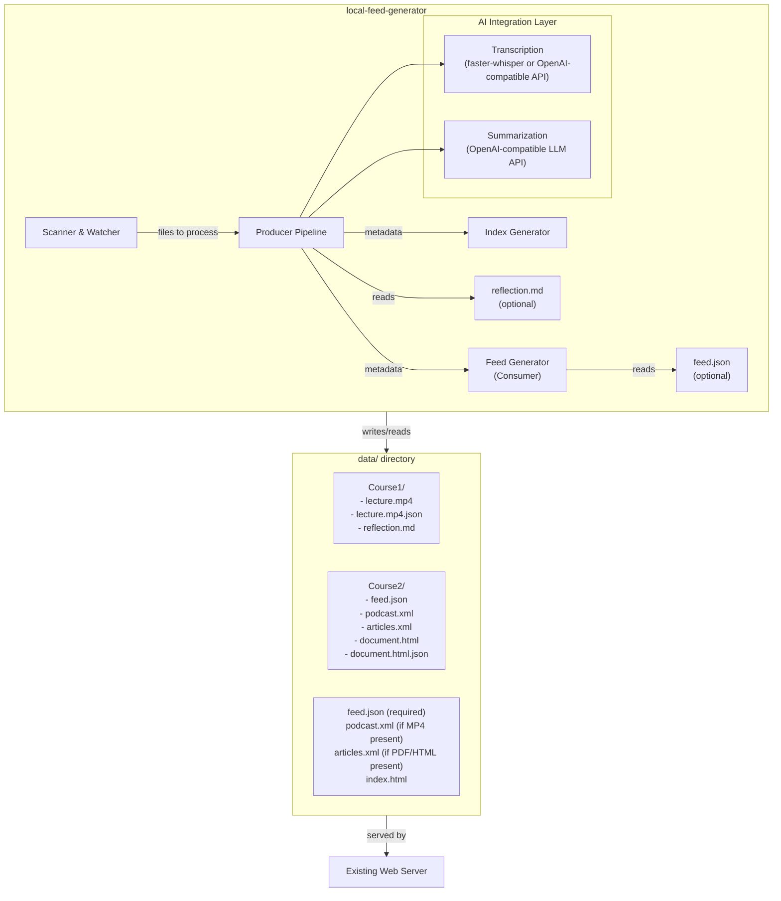
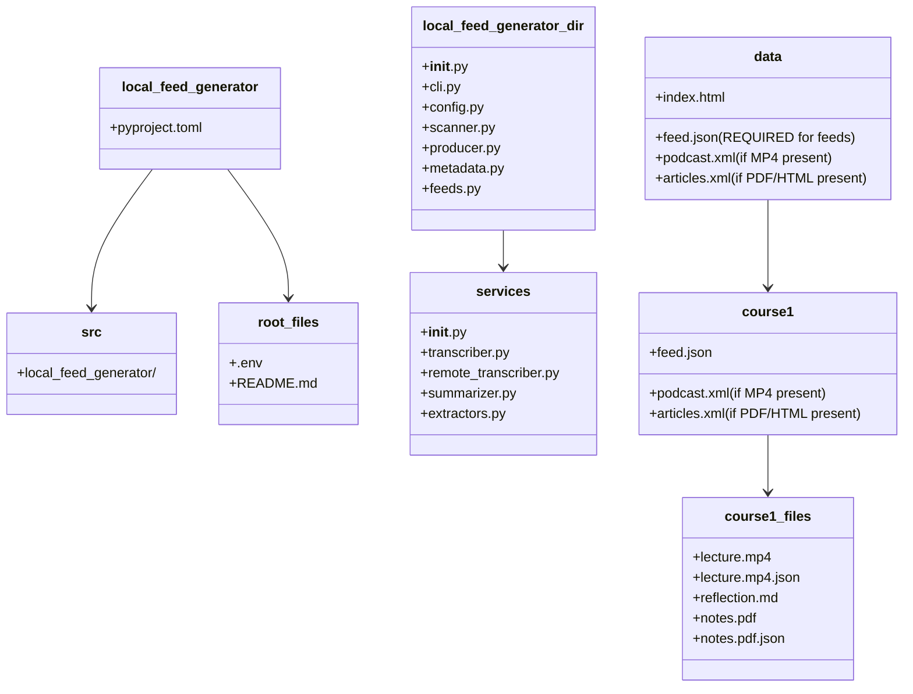
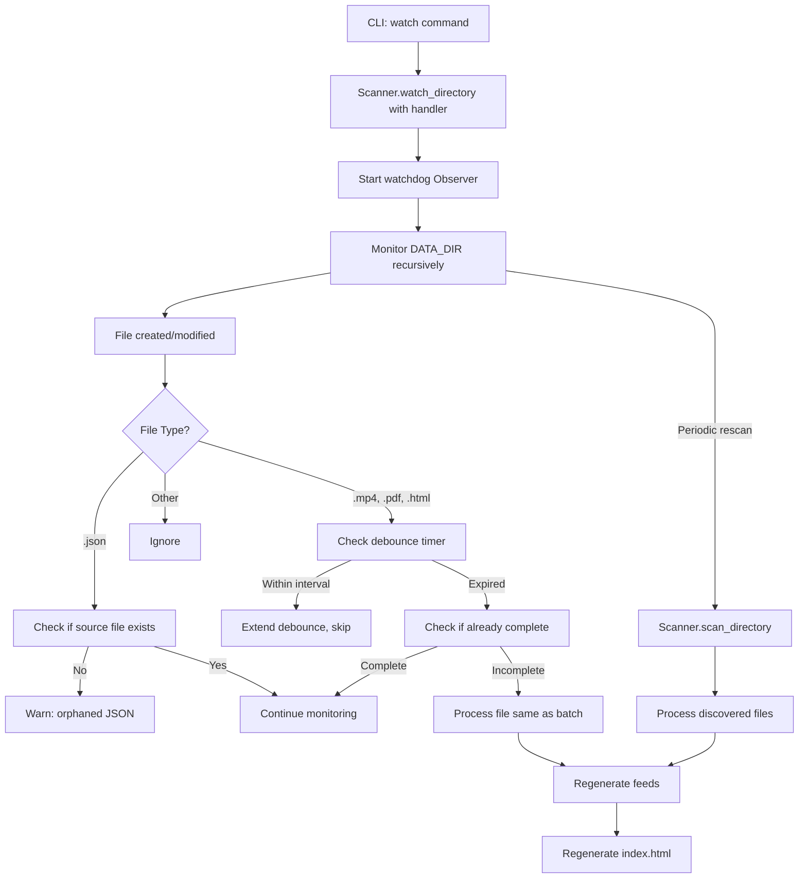

# Local Feed Generator - Design Document

**Application Name:** `local-feed-generator`

---

## 1. Overview

The `local-feed-generator` is a standalone application that processes content files (PDF, HTML, MP4) in a `data` directory and generates RSS feeds for personal consumption through mobile applications. The system supports both local and remote transcription: by default, it uses GPU-accelerated open-weight models (faster-whisper) for audio transcription; when configured with a remote endpoint via `TRANSCRIPTION_ENDPOINT`, it automatically uses an OpenAI-compatible API for transcription instead. Summarization always uses OpenAI-compatible local LLMs.

### 1.1 System Goals

- **Privacy-first:** All processing happens on local infrastructure (Nvidia GPU)
- **Minimal dependencies:** Uses open-weight models and standard libraries
- **Idempotent processing:** Skips files with existing metadata; processes only new/changed files
- **Mobile-ready:** Generates standard-compliant feeds consumable by Antennapod (podcast) and any RSS reader (articles)
- **Configurable:** System prompts, feed formats, and runtime parameters via environment variables
 - **Flexible organization:** Supports per-folder feed generation with custom titles and descriptions
 - **Conditional feeds:** Feeds are only generated where feed.json exists and applicable files are present
 - **Root index page:** Auto-generates root-level index.html for feed discovery
 - **Enhanced content:** Extracts content from PDF/HTML files, not just metadata

---

## 2. Architecture

### 2.1 System Boundaries



Note: Root-level feeds (podcast.xml, articles.xml, index.html) are ONLY generated if feed.json exists in the root and applicable files are present.

### 2.2 Major Components

- **Scanner & Watcher** (`watchdog`): Discovers files in `data/`; detects new/changed files; triggers processing; implements debouncing and periodic rescan
- **Producer Pipeline** (Python): Orchestrates file processing; manages queue; generates metadata
  - **Transcription Service** (`faster-whisper` + CUDA or OpenAI-compatible API): Converts MP4 audio to markdown text using either local (faster-whisper) or remote (OpenAI-compatible API) mode. The system implements a dual-mode architecture with the `RemoteTranscriber` class for API-based transcription and the local `Transcriber` class for GPU-accelerated transcription.
- **Summarization Service** (`openai` client \=> local LLM): Generates key takeaways from transcripts; supports reflection questions from `reflection.md` files; works with both MP4 transcripts and PDF/HTML extracted content
- **Extraction Service** (`pypdf`, `beautifulsoup4`, `ffprobe`): Extracts metadata AND content from PDF/HTML files; extracts audio metadata (duration, creation_time) from MP4 files
  - **Feed Generator** (`feedgen`): Aggregates metadata; generates RSS feeds; supports per-folder feeds via `feed.json`; converts markdown to HTML; only generates feeds where feed.json exists and applicable files are present
 - **Index Generator**: Generates root-level index.html with all available feeds; lists feeds with titles and descriptions
 - **Configuration** (`pydantic-settings` + `.env`): Manages runtime settings including new prompt variables
- **CLI** (`click`): Command-line interface with granular subcommands

### 2.3 Data Flow

```mermaid
flowchart TD
    A[Scanner discovers file] --> B{*.json exists?}
    B -->|Yes| C[Check if complete]
    C -->|Complete| D[Skip - idempotent]
    C -->|Incomplete| E[Process file]
    B -->|No| E
    
    E --> F[Determine file type]
    
    F -->|MP4| G[Check reflection.md]
    G -->|Exists| H[Load reflection questions]
    G -->|No| I[Use standard prompt]
    H --> J[Transcribe to markdown]
    I --> J
    J --> K[Store in content field]
    K --> L[Summarize with reflection]
    L --> M[Store summary in summary field]
    M --> N[Extract audio metadata]
    N --> O[Generate title dict (filename, extracted, generated with prompt: filename+extracted+content)]
    O --> P[Apply module prefix]
    
    F -->|PDF| Q[Extract metadata & content]
    Q --> R[Store in description & content]
    R --> S[Check reflection.md]
    S -->|Exists| T[Optional: summarize content]
    S -->|No| U[Set summary to null]
    T --> U
    Q --> V[Build sanitized filename (no extension, no underscores)]
    V --> W[Build title dict with sources]
    W --> X[Apply module prefix]
    
    F -->|HTML| Y[Extract metadata & content]
    Y --> R
    Y --> V
    
    P --> Z[Write .json with title dict]
    X --> Z
    U --> Z
    Z --> AA[JSON with step maps]
    
    AA --> AB[Feed Generator discovers metadata]
    AB --> AC[Check for feed.json files]
    AC -->|Exists| AD[Check for applicable files]
    AD -->|MP4 present| AE[Generate podcast.xml]
    AD -->|PDF/HTML present| AF[Generate articles.xml]
    AD -->|No applicable files| AG[Skip feed generation]
    AC -->|No feed.json| AH[Skip folder]
    AE --> AI[Generate root index.html]
    AF --> AI
    AG --> AI
    
    AI --> AJ[Convert markdown to HTML]
    AJ --> AK[Write feeds and index]
```

---

## 3. Interfaces & Contracts

### 3.1 CLI Interface

```bash
# Process all files in data/ directory (batch mode)
uv run local-feed-generator process --data-dir ./data

# Process a single file
uv run local-feed-generator process --data-dir ./data --file videos/lecture.mp4

# Force reprocessing of a file
uv run local-feed-generator process --data-dir ./data --file videos/lecture.mp4 --force

# Watch data/ directory for changes (incremental mode)
uv run local-feed-generator watch --data-dir ./data

# Generate feeds only (no processing)
uv run local-feed-generator feeds --data-dir ./data

# Validate all metadata files and finalize JSON
uv run local-feed-generator validate --data-dir ./data

# Transcribe MP4 files to markdown text
uv run local-feed-generator transcribe --data-dir ./data

# Transcribe a specific file
uv run local-feed-generator transcribe --data-dir ./data --file videos/lecture.mp4

# Preview which files would be transcribed (no changes)
uv run local-feed-generator transcribe --data-dir ./data --dry-run

# Generate summaries from transcripts or extracted content
uv run local-feed-generator summarize --data-dir ./data

# Summarize a specific file (MP4, PDF, or HTML)
uv run local-feed-generator summarize --file documents/report.pdf

# Summarize a PDF/HTML file with reflection questions
uv run local-feed-generator summarize --file documents/report.pdf --force

# Extract metadata from PDF/HTML files
uv run local-feed-generator extract --data-dir ./data
```

#### Subcommands

- **`process`**: Process all files in data directory (batch mode)
- **`watch`**: Watch for changes and process incrementally
 - **`feeds`**: Generate RSS feeds from existing JSON metadata; supports per-folder feeds via feed.json; generates root-level index.html; only generates feeds where feed.json exists and applicable files are present
- **`validate`**: Validate all metadata files and finalize incomplete ones by setting step completion statuses
- **`transcribe`**: Transcribe MP4 files using local or remote mode
- **`summarize`**: Generate summaries from existing transcripts or extracted content; uses reflection questions if available; works with MP4, PDF, and HTML files
- **`extract`**: Extract metadata and content from PDF/HTML files

#### Flags

- **`--data-dir <path>`** (All commands): Path to the data directory. Defaults to `DATA_DIR` from configuration.
- **`--config-file <path>`** (All commands): Path to a `.env`-style configuration file.
- **`--file <path>`** (All commands): Process only the specified file instead of scanning the entire directory. Takes precedence over `--data-dir`.
- **`--force`** (All commands): Force execution even if the step appears already complete.
- **`--dry-run`** (transcribe, summarize, extract): Show which files would be processed without making any changes.

### 3.2 Environment Configuration

The application uses the following environment variables:

```bash
# Required
BASE_URL=https://example.com/feeds        # Root URL for feed enclosure links
DATA_DIR=./data                           # Path to data directory

# LLM Configuration
LLM_ENDPOINT=https://llm.example.com/v1
LLM_API_KEY=your-api-key-here
LLM_MODEL=mistralai/Mistral-7B-Instruct

# NEW: Required prompt configuration
SUMMARY_PROMPT="Summarize key takeaways from the given content. Output just the summary concisely."
TITLE_PROMPT="Generate a concise, descriptive title (5-10 words) for the given content. Do not include any formatting, quotes, or extra text."

# Optional: Reflection prompt
SUMMARY_REFLECTION_PROMPT="Summarize key takeaways focusing on frameworks or analytical tools to develop critical, creative, and systems thinking."

# Transcription Configuration
TRANSCRIPTION_MODEL=large-v3-turbo
TRANSCRIPTION_DEVICE=cuda
TRANSCRIPTION_COMPUTE_TYPE=float16

# Remote Transcription Configuration (optional - enables remote mode when TRANSCRIPTION_ENDPOINT is set)
TRANSCRIPTION_ENDPOINT=https://api.example.com/v1/audio/transcriptions  # URL for remote transcription API
TRANSCRIPTION_API_KEY=your-api-key-here                              # API key for remote transcription endpoint
TRANSCRIPTION_REMOTE_MODEL=whisper-1                                  # Model override for remote endpoint (not passed by default)
```

### 3.3 JSON Metadata Schema

Each processed file has a corresponding `.json` file with the same name in the same directory:

```json
{
  "title": {
    "filename": "lecture",      // sanitized filename with no extension, no underscores
    "extracted": "Lecture 1",   // from source metadata (PDF metadata, HTML <title>, or MP4 metadata where available)
    "generated": "LLM Title"   // LLM-generated with prompt including filename and extracted title before content
  },
  "extracted_title": "Lecture 1",  // extracted title stored separately (optional)
  "description": "Extracted metadata description",  // For MP4: blank; For PDF/HTML: extracted metadata
  "summary": "LLM-generated key takeaways",         // For MP4 only (unless PDF/HTML explicitly summarized); For PDF/HTML: null by default
  "content": "Full transcript or extracted text",   // For MP4: full transcript; For PDF/HTML: extracted plaintext
  "filename": "lecture.mp4",
  "filepath": "Course1/lecture.mp4",
  "filetype": "mp4|pdf|html",
  "date": 1728931200.123,          // UNIX epoch (float, millisecond precision)
  "duration": 3600.5,             // For MP4: duration in seconds (float, optional)
  "creation_time": "2024-01-15T10:30:00.000000Z",  // ISO-8601 (MP4 only, from audio metadata)
  "size": 12345678,
  
  "transcribe": {
    "status": null | "in_progress" | "complete",
    "start_time": 1792096505.123,   // UNIX epoch (millisecond precision)
    "end_time": 1792096515.456,     // UNIX epoch (millisecond precision)
    "input_size": 12345678,
    "output_size": 456789,
    "words": 452,
    "model": "large-v3-turbo",
    "input_tokens": null,           // optional, for API-based transcription
    "output_tokens": null           // optional, for API-based transcription
  },
  
  "summarize": {
    "status": null | "in_progress" | "complete",
    "start_time": 1792096515.123,
    "end_time": 1792096520.456,
    "input_size": 456789,
    "output_size": 1997,
    "words": 345,
    "model": "mistralai/Mistral-7B-Instruct",
    "input_tokens": 890,
    "output_tokens": 123
  },
  
  "extract": null | {
    "status": null | "in_progress" | "complete",
    "start_time": 1792096500.123,
    "end_time": 1792096505.456,
    "input_size": 1790891,
    "output_size": 12345,
    "words": 543
  },
  
  "error": "string (optional, only when processing failed)"
}
```

**Field Descriptions:**
- `title`: **NEW - Now a dict** with keys: `filename` (sanitized filename with no extension, no underscores), `extracted` (from source metadata), `generated` (LLM-generated with prompt including filename and extracted title before content)
- **Title Precedence:** filename < extracted < generated (generated takes highest precedence, filename lowest)
- `extracted_title`: **NEW** - Title extracted from source metadata (PDF metadata title, HTML `<title>` tag). Stored separately and also used in title dict for tracking.
- `description`: For MP4 files, this is blank. For PDF/HTML files, this contains extracted metadata.
- `summary`: For MP4 files, this contains LLM-generated key takeaways. For PDF/HTML files, this is null by default (can be populated by running the `summarize` command on the file).
- `content`: For MP4 files, this contains the full transcript. **NEW: For PDF/HTML files, this contains extracted plaintext content.**
- `filepath`: Relative path from `data/` directory root
- `date`: Publication/creation date stored as UNIX epoch **float with millisecond precision** (e.g., 1728931200.123)
- `creation_time`: ISO-8601 formatted creation timestamp (from audio metadata via ffprobe)
- `duration`: For MP4 files, duration in seconds (float). Extracted via ffprobe when available.
- `size`: File size in bytes (for podcast enclosure `length`)
- `error`: Optional; contains error message if any step failed
- `transcribe`, `summarize`, `extract`: Step maps tracking processing steps. Each contains a `status` field (null, "in_progress", "complete") and detailed timing/metrics with **millisecond precision**

**Note:** The absolute URL for feed enclosures is computed when generating feeds by combining `BASE_URL` + `filepath`.

**Feed Eligibility Rules:**
- **MP4 files**: `feed_eligible = (transcribe.status == "complete" AND summarize.status == "complete")`
- **PDF/HTML files**: `feed_eligible = (extract.status == "complete")`
- Items with `feed_eligible = false` are excluded from feeds

**Backwards Compatibility:** When loading JSON files with deprecated fields (`transcribe_status`, `summarize_status`, `extract_status`, `stage`, string `status`, `transcript`, `processing_date`, `completed_at`, `started_at`), a warning is printed to stderr. Deprecated fields are ignored (not migrated).

**NEW Features in Schema:**
- Title as dict with source tracking
- extracted_title field for source metadata
- content field now used for extracted text from PDF/HTML
- Millisecond precision timestamps
- duration field for MP4 files
- creation_time field for MP4 files
- summarize command can process PDF/HTML files to populate summary field

### 3.4 Feed Output

Two or more feed files are generated based on feed.json configuration:
 - `podcast.xml` - Contains all MP4 files with enclosures (only generated if feed.json exists AND MP4 files present)
 - `articles.xml` - Contains all PDF/HTML files (only generated if feed.json exists AND PDF/HTML files present)
 - `index.html` - Lists all available feeds (generated at root level if feed.json exists)

For podcast feed items:
- Title from metadata title dict's final title computation
- Description from `summary` field (LLM-generated key takeaways)
- Enclosure: URL, type="audio/mp4", length (file size from `size` field)
- Publication date from metadata `date` field

For articles feed items:
- Title from metadata title dict's final title computation
- Description from `content` field (if available) or `description` field
- Link to the source file
- Publication date from metadata `date` field

 **NEW Features:**
 - **Markdown to HTML conversion**: Descriptions are converted from markdown to HTML with XSS protection
 - **Per-folder feeds**: When a folder contains `feed.json`, feeds are generated in that folder with custom titles/descriptions
 - **Conditional feed generation**: Feeds only generated if both feed.json exists AND applicable file types are present
 - **Index page**: Root-level index.html listing all available feeds
 - **Safe links**: Only allows safe URL schemes (http, https, mailto, relative paths, fragments)

**Feed Item Sorting:** Folder name (ascending), then filename (ascending)

### 3.5 Per-Folder Feed Configuration (feed.json)

**IMPORTANT:** Feeds are ONLY generated in folders that contain a `feed.json` file. Root-level feeds require a feed.json in the data directory root.

When a `feed.json` file exists in a subfolder of `data/`, the system generates feeds in that folder:

```json
{
  "title": "Course 1: Introduction to AI",
  "description": "All materials for Course 1 covering AI fundamentals",
  "language": "en-us",
  "author": "Course Author",
  "link": "https://example.com/course1",
  "image": {
    "url": "https://example.com/course1-logo.png",
    "title": "Course 1 Logo",
    "link": "https://example.com/course1"
  }
}
```

The `feed.json` file can contain:
- `title`: Custom title for the feeds generated in this folder (required)
- `description`: Custom description for the feeds generated in this folder (optional)
- `language`: Language code for the feed (optional, e.g., "en-us")
- `author`: Feed author name (optional)
- `link`: URL to the feed's homepage (optional)
- `image`: Feed image/logo with `url`, `title`, and `link` subfields (optional)

When `feed.json` exists:
 - `podcast.xml` is generated in that folder **only if MP4 files with feed_eligible=true exist in the subtree**
 - `articles.xml` is generated in that folder **only if PDF/HTML files with feed_eligible=true exist in the subtree**
 - Only items within that folder's subtree are included in the feeds
 - Custom title and description from `feed.json` are used
 - Root-level feeds require their own feed.json (not generated by default)

### 3.6 Reflection Questions (reflection.md)

When a `reflection.md` file exists in a folder containing MP4, PDF, or HTML files, the system uses its content as reflection questions for summarization:

```markdown
# Reflection Questions

1. What are the key frameworks or mental models presented?
2. What analytical tools can help develop critical thinking?
3. How does this content relate to systems thinking?
```

When processing files in that folder:
- Reflection questions are read from `reflection.md`
- Questions are prepended to the transcript or extracted content
- System uses `SUMMARY_REFLECTION_PROMPT` (or falls back to `SUMMARY_PROMPT`)
- LLM focuses summary on answering the reflection questions
- Works with both MP4 files (transcripts) and PDF/HTML files (extracted content) via the `summarize` command

### 3.7 Index.html Generation

The system automatically generates a root-level `index.html` file to provide a discovery mechanism for feeds.

**Generation Rules:**
 - `index.html` is generated at the root level if feed.json exists
 - Contains links to all feeds that actually exist (podcast.xml and articles.xml from all folders with feed.json)
 - Includes feed titles and descriptions from each feed.json
 - Uses simple, clean HTML that works with any browser

**Purpose:**
 - Easy discovery of all available feeds
 - Human-readable directory structure
 - Self-documenting feed organization
 - Central access point for all content

---

## 4. Technology Stack

### 4.1 Dependencies

**Required dependencies:**
- **`feedgen`**: RSS feed generation with podcast extension
- **`watchdog`**: File system monitoring for incremental mode
- **`openai`**: Client for OpenAI-compatible LLM API and remote transcription API
- **`pydantic-settings`**: Configuration management with environment variables
- **`pydantic`**: Data validation for metadata
- **`click`**: CLI interface
- **`pypdf`**: PDF metadata and content extraction
- **`beautifulsoup4`**: HTML metadata and content extraction
- **`python-dotenv`**: For loading .env files

**Optional dependencies:**
- **`faster-whisper`**: GPU-accelerated audio transcription (local mode)
- **`av`**: Audio/video library for media decoding (required by faster-whisper, pinned to compatible version)
- **`markdown`**: Enhanced markdown to HTML conversion (fallback to built-in converter if not installed)
- **`ffprobe`**: Command-line tool for audio metadata extraction (duration, creation_time, bit_rate)

#### 4.1.1 AV Library Compatibility Issue

**Issue:** `faster-whisper` passes `metadata_errors="ignore"` to `av.open()`, but a newer `av` release removed this parameter.

**Error:** `TypeError: av.open() got an unexpected keyword argument 'metadata_errors'`

**Root Cause:** Breaking change in `av` library between releases.

**Context:** `faster-whisper` uses CTranslate2 which handles audio decoding through the `av` library. The parameter `metadata_errors` was valid in an earlier release but was removed in a later release.

**Fix Applied:** Pinned `av` in `pyproject.toml` dependencies to `av>=11.0,<19.0` to prevent installation of incompatible releases.

**Recommendation:** Pin `av` in production deployments. Users should be aware of this dependency conflict when managing their environments.

**Future Consideration:** Monitor `faster-whisper` updates that may resolve this compatibility issue with newer `av` releases.

### 4.2 Transcription Engine Selection

**Dual-Mode Support:** The transcription system supports both local and remote modes. When `TRANSCRIPTION_ENDPOINT` is configured, the system automatically switches to remote transcription mode and uses the OpenAI-compatible API for all transcription tasks. When `TRANSCRIPTION_ENDPOINT` is not configured, the system defaults to local transcription using `faster-whisper`.

**Recommendation (Local Mode):** `faster-whisper` with `large-v3-turbo` model on CUDA with float16

#### Mode Selection Logic

- **Remote Mode**: Enabled when `TRANSCRIPTION_ENDPOINT` is set. Uses OpenAI-compatible API for transcription via the `RemoteTranscriber` class which implements `transcribe()` method that uploads audio files to the remote endpoint and retrieves the transcript.
- **Local Mode**: Used when `TRANSCRIPTION_ENDPOINT` is not configured. Uses `faster-whisper` with GPU acceleration.
- **Model Override**: The `TRANSCRIPTION_REMOTE_MODEL` variable is optional and not passed to the remote endpoint by default. When specified, it overrides the default model selection on the remote endpoint.

#### Fallback Behavior

- **Remote Mode Priority**: When `TRANSCRIPTION_ENDPOINT` is configured, remote mode becomes the default and is used exclusively. The system does **not** automatically fall back to local transcription if the remote endpoint fails.
- **Error Handling**: If remote transcription fails (connection errors, API errors, authentication errors, or audio duration limits reached), the error is captured and recorded in the JSON metadata. The file processing is marked as failed and excluded from feeds.
- **Manual Fallback**: To switch from remote to local mode, the user must unset or remove the `TRANSCRIPTION_ENDPOINT` configuration and reprocess the affected files.

#### Remote Mode Configuration Requirements

When using remote transcription mode, the following server-side configuration must be in place:

- **OpenAI-Compatible API**: The remote endpoint must implement the OpenAI audio transcription API format (POST to `/v1/audio/transcriptions` with audio file upload)
- **Authentication**: The endpoint must accept the API key provided in `TRANSCRIPTION_API_KEY`
- **vLLM Server Configuration**: If using vLLM as the remote transcription endpoint, the server requires `VLLM_MAX_AUDIO_DECODE_DURATION_S` environment variable to be set to a value (in seconds) that accommodates the longest audio files. For example: `VLLM_MAX_AUDIO_DECODE_DURATION_S=3600` allows for 1-hour audio files. Without this configuration, the server may reject longer audio files with "Audio exceeds maximum allowed duration" errors.
- **Model Support**: The remote endpoint must support the transcription model being used (default or specified via `TRANSCRIPTION_REMOTE_MODEL`)

#### RemoteTranscriber Class Implementation Details

The `RemoteTranscriber` class is implemented in `src/local_feed_generator/services/remote_transcriber.py` and provides:

- **API Client**: Uses the OpenAI Python SDK client configured with the remote endpoint URL and API key
- **Audio Upload**: Sends `multipart/form-data` requests with the audio file and optional model parameter
- **Configuration Integration**: Reads from `TRANSCRIPTION_ENDPOINT`, `TRANSCRIPTION_API_KEY`, and `TRANSCRIPTION_REMOTE_MODEL` environment variables
- **Error Handling**: Catches and propagates API errors (connection errors, HTTP errors, authentication errors, rate limiting, and audio duration limits)
- **Response Parsing**: Extracts the transcript text from the OpenAI-compatible API response format. The client handles both plain text and JSON response formats; **note that vLLM servers return JSON even with `response_format="text"`**, so the client extracts the text field from the JSON response.

#### Why faster-whisper? (Local Mode)

Given that **GPU support is critical** and **RAM is not a limitation**, with **best transcription quality as the top priority**, **faster-whisper** is the optimal choice for local transcription.

**faster-whisper** is a reimplementation of OpenAI's Whisper model using [CTranslate2](https://github.com/OpenNMT/CTranslate2/), offering:

- **2-4x faster** than original PyTorch Whisper at same accuracy
- **Full CUDA support** for Nvidia GPUs
- **Float16 precision** for highest quality without quantization
- **Python-native API** for seamless integration
- **Batch processing** support for efficient file handling
- **Accurate parity** with original Whisper models

#### Transcription Quality Comparison

| Model | Size | Accuracy | Speed (GPU) | Language Support |
|-------|------|----------|-------------|------------------|
| `tiny` | 39M | Basic | Fastest | Multilingual |
| `base` | 74M | Good | Fast | Multilingual |
| `small` | 244M | Very Good | Moderate | Multilingual |
| `medium` | 769M | Excellent | Moderate | Multilingual |
| **`large-v3-turbo`** | **~800M** | **Best** | **Good** | **Multilingual** |
| `large-v3` | 1550M | Best (slower) | Good | Multilingual |

**For this project (Local Mode):** Use `large-v3-turbo` with CUDA + float16 for maximum transcription quality.

**Remote Mode Considerations:** When using remote transcription, ensure the endpoint is compatible with OpenAI's audio transcription API format. The remote endpoint determines the default model unless `TRANSCRIPTION_REMOTE_MODEL` is explicitly configured.

### 4.3 Summarization Model

**Recommendation:** Any OpenAI-compatible model with 128K+ context window
- **API:** OpenAI-compatible endpoint (as specified in `LLM_ENDPOINT`)
- **System Prompts:** Configurable via `SUMMARY_PROMPT`, `SUMMARY_REFLECTION_PROMPT`, and `TITLE_PROMPT` environment variables
- **Content Sources:** Works with MP4 transcripts, PDF extracted content, and HTML extracted content

### 4.4 Content Extraction

**PDF Extraction:** Uses `pypdf` library to extract:
- Metadata: title, author, creation date
- Content: Plaintext from all pages
- **NEW:** Removes control characters that are invalid in XML

**HTML Extraction:** Uses `BeautifulSoup` to extract:
- Metadata: `<title>` tag, `<meta name="description">`, date from various sources
- Content: Plaintext from document body (tags removed)
- **NEW:** Removes control characters that are invalid in XML

**Audio Metadata Extraction:** Uses `ffprobe` command-line tool to extract:
- Duration in seconds
- Creation time (ISO-8601 string)
- Bit rate
- Format information
- Falls back to file modification time if ffprobe is not installed

---

## 5. Directory Structure



**Project Layout:**
```
local-feed-generator/
\u251c\u2500\u2500 pyproject.toml
\u251c\u2500\u2500 src/local_feed_generator/
\u2502   \u251c\u2500\u2500 __init__.py
\u2502   \u251c\u2500\u2500 cli.py
\u2502   \u251c\u2500\u2500 config.py
\u2502   \u251c\u2500\u2500 scanner.py
\u2502   \u251c\u2500\u2500 producer.py
\u2502   \u251c\u2500\u2500 services/
\u2502   \u2502\u2500 \u251c\u2500\u2500 __init__.py
\u2502   \u2502\u2500 \u251c\u2500\u2500 transcriber.py
\u2502   \u2502\u2500 \u251c\u2500\u2500 remote_transcriber.py
\u2502   \u2502\u2500 \u251c\u2500\u2500 summarizer.py
\u2502   \u2502\u2500 \u251c\u2500\u2500 extractors.py
   \u2502   \u251c\u2500\u2500 metadata.py
   \u2502   \u251c\u2500\u2500 feeds.py
\u251c\u2500\u2500 .env
\u2514\u2500\u2500 README.md

data/
\u251c\u2500\u2500 feed.json                    # REQUIRED: Root-level feed config
\u251c\u2500\u2500 podcast.xml                  # Generated only if MP4 files present
\u251c\u2500\u2500 articles.xml                 # Generated only if PDF/HTML files present
\u251c\u2500\u2500 index.html                   # Root-level index page
\u251c\u2500\u2500 Course1/
\u2502   \u251c\u2500\u2500 feed.json               # REQUIRED: Per-folder feed config
\u2502   \u251c\u2500\u2500 podcast.xml             # Generated only if MP4 files present
\u2502   \u251c\u2500\u2500 articles.xml            # Generated only if PDF/HTML files present
\u2502   \u251c\u2500\u2500 lecture.mp4
\u2502   \u251c\u2500\u2500 lecture.mp4.json        # Metadata with title dict, step maps, ms precision
\u2502   \u251c\u2500\u2500 reflection.md           # Optional: reflection questions
\u2502   \u2514\u2500\u2500 notes.pdf
\u2502       \u2514\u2500\u2500 notes.pdf.json
\u2514\u2500 Course2/
    \u251c\u2500\u2500 feed.json
    \u251c\u2500\u2500 podcast.xml (only if MP4 present)
    \u251c\u2500\u2500 articles.xml (only if PDF/HTML present)
    \u251c\u2500\u2500 document.html
    \u2514\u2500\u2500 document.html.json
```

### 5.2 Module Responsibilities

#### Scanner
- Discovers all MP4, PDF, HTML files in the data directory
- Batch mode: Returns list of files without corresponding JSON metadata or with incomplete step maps
- Incremental mode: Watches for file system changes and triggers processing
- Validates filenames for special characters (warnings only)
- Detects orphaned JSON files (JSON without source file)
- **NEW:** Implements debouncing to prevent rapid successive events
- **NEW:** Implements periodic rescan as fallback for unreliable file systems

#### Producer
- Orchestrates file processing based on file type
- For MP4 files: Requests transcription, then summarization (with optional reflection questions), extracts audio metadata, generates title dict with sources (filename, extracted, generated) and precedence (filename < extracted < generated), applies module prefix
- For PDF/HTML files: Extracts metadata AND content, generates title dict with sources (filename, extracted, generated) and precedence (filename < extracted < generated), set summary to null (unless explicitly summarized), applies module prefix
- **NEW:** Can generate summaries for PDF/HTML files when explicitly requested via summarize command
- Generates JSON metadata file adjacent to source file with step maps, millisecond precision timestamps, title dict
- Handles errors gracefully, writing error metadata
- **NEW:** Checks for `reflection.md` files and passes questions to summarizer
- **NEW:** Extracts audio metadata (duration, creation_time) using ffprobe
- **NEW:** Builds title as dict with sources (filename=sanitized no extension/no underscores, extracted=from metadata, generated=LLM with filename+extracted in prompt)
- **NEW:** Applies module name prefix to titles when appropriate

#### Transcription Service
- Converts MP4 audio to markdown text
- Uses faster-whisper with CUDA GPU acceleration for highest quality
- No timestamps in output (clean transcript only)
- Tracks processing in the `transcribe` step map with millisecond precision timing
- Handles errors and propagates them with context

#### Remote Transcription Service
- **NEW:** Provides remote transcription via OpenAI-compatible API
- Uses `RemoteTranscriber` class in `services/remote_transcriber.py`
- Supports retry logic with exponential backoff and jitter
- Handles various API errors (connection, authentication, rate limiting, etc.)
- Falls back to using `TRANSCRIPTION_REMOTE_MODEL` or `TRANSCRIPTION_MODEL`
- Parses both text and JSON responses (vLLM returns JSON even with response_format="text")

#### Summarization Service
- Generates key takeaways from audio transcripts and extracted content
- Uses configured OpenAI-compatible LLM endpoint
- Generates titles from content with prompt including filename and extracted title before content. TITLE_PROMPT includes instructions to use extracted or filename titles when generating.
- Tracks processing in the `summarize` step map with millisecond precision timing
- **NEW:** Accepts optional reflection questions parameter
- **NEW:** Uses `SUMMARY_PROMPT` or `SUMMARY_REFLECTION_PROMPT` based on context
- **NEW:** Works with both MP4 transcripts and PDF/HTML extracted content
- Handles API errors with retry logic

#### Extractors Service
- Extracts metadata (including title) from PDF files using PyPDF
- Extracts metadata (including title from <title> tag) from HTML files using BeautifulSoup
- **NEW:** Extracts plaintext content from PDF (all pages) and HTML (body text)
- **NEW:** Removes control characters that are invalid in XML from extracted content
- **NEW:** Extracts audio metadata using ffprobe (duration, creation_time, bit_rate)
- Tracks processing in the `extract` step map with millisecond precision timing
- Return structured data compatible with Metadata model

#### Feed Generator
- Reads all JSON metadata files from data directory
- Filters entries by feed_eligible computed property (which checks the step map status values)
- For MP4: Uses `summary` field for feed item descriptions
- For PDF/HTML: Uses `content` field (if available) or `description` field for feed item descriptions
- Generates podcast feed for MP4 files with enclosures
- Generates articles feed for PDF/HTML files
- Sorts items by folder name, then filename
- Writes feeds to data directory root and optionally to subfolders with feed.json
- **NEW:** Only generates feeds where feed.json exists AND applicable files are present
- **NEW:** Converts markdown in descriptions to HTML with XSS protection
- **NEW:** Supports per-folder feed generation via feed.json files
- **NEW:** Validates feeds for XML well-formedness and RSS compliance

#### Index Generator
 - Scans for feed.json files in the data directory
 - Generates root-level index.html with links to all available feeds from all folders with feed.json
 - Includes feed titles and descriptions from each feed.json
 - Uses simple HTML generation (no external templates)
 - Regenerates automatically when feeds are regenerated

---

## 6. Data Flow Details

### 6.1 Batch Processing Flow

Audio files (MP4) are transcribed using either local (faster-whisper) or remote (OpenAI-compatible API) transcription based on the configuration. When `TRANSCRIPTION_ENDPOINT` is set, remote mode is used; otherwise, local mode with faster-whisper is used.

```mermaid
flowchart TD
    A[CLI: process command] --> B[Scanner.scan_directory]
    B -->|Recursively walks DATA_DIR| C[Finds .mp4, .pdf, .html]
    C --> D[Filters out files with complete JSON]
    D --> E[Returns list of files]
    
    E --> F[For each file: Producer.process_file]
    F --> G{File Type?}
    
    G -->|MP4| H1[Check for reflection.md]
    H1 -->|Exists| H2[Load reflection questions]
    H1 -->|No| H3[Use standard prompt]
    H2 --> I1[Transcribe via local or remote]
    H3 --> I1
    I1 --> J1[Store transcript in content field]
    J1 --> K1[Summarize with reflection if available]
    K1 --> L1[Store summary in summary field]
    L1 --> M1[Extract audio metadata via ffprobe]
    M1 --> N1[Build title dict with sources]
    N1 --> O1[Apply module prefix]
    O1 --> P1[Set description to blank]
    P1 --> Q1[Write .json with step maps]
    
    G -->|PDF| H4[Extract metadata & content]
    H4 --> K2[Store metadata in description]
    K2 --> L2[Store content in content field]
    H4 --> M2[Build sanitized filename (no extension, no underscores)]
    M2 --> N2[Build title dict with sources]
    N2 --> O2[Apply module prefix]
    O2 --> Q2[Set summary to null]
    Q2 --> Q1
    
    G -->|HTML| H5[Extract metadata & content]
    H5 --> K3[Store metadata in description]
    K3 --> L3[Store content in content field]
    H5 --> M3[Build sanitized filename (no extension, no underscores)]
    M3 --> N3[Build title dict with sources]
    N3 --> O3[Apply module prefix]
    O3 --> Q3[Set summary to null]
    Q3 --> Q1
    
    Q1 --> R[All files processed]
    R --> S[Feed Generator discovers metadata]
    S --> T[Generate podcast.xml and articles.xml for each folder with feed.json]
    T --> U[Index Generator generates root index.html with all feeds]
    U --> V[Write all files]
```

**Key Processing Steps:**
1. Scanner discovers files needing processing (no JSON, incomplete JSON, or source newer than JSON)
2. Producer processes each file based on type
3. For MP4: Transcribe => Summarize (with optional reflection) => Extract audio metadata => Build title dict (filename, extracted, generated with prompt including filename+extracted) with precedence (filename < extracted < generated) => Build metadata
4. For PDF/HTML: Extract metadata & content => Build title dict (filename, extracted, generated with prompt including filename+extracted) with precedence (filename < extracted < generated) => Build metadata
5. All steps populate step maps with millisecond precision timestamps
6. Feed generator creates feeds from all valid metadata, with markdown to HTML conversion
7. Index generator creates root-level index.html with all feeds
8. Per-folder feeds generated when feed.json exists AND applicable files are present

### 6.2 Incremental Processing Flow

Incremental processing uses the same transcription mode selection as batch processing. MP4 files are transcribed either locally via faster-whisper or remotely via OpenAI-compatible API, depending on the `TRANSCRIPTION_ENDPOINT` configuration.



**Incremental Features:**
- Debouncing: Rapid successive events for the same file are collapsed
- Periodic rescan: Fallback for file systems that don't reliably trigger events
- Event-driven: New and modified files trigger immediate processing
- Error resilience: Single file processing errors don't stop the watcher
- Feed regeneration: Feeds and index.html are regenerated after each file processing

---

## 7. Error Handling

### 7.1 Processing Errors

When an error occurs during processing:
1. Catch the exception
2. Create metadata with appropriate error state (step maps set to null, error field populated)
3. Write `.json` file to disk
4. **Exclude from feeds** (filter by feed_eligible computed property)
5. Log error to stderr
6. In watch mode: Continue monitoring (don't crash the watcher)

### 7.2 Special Characters in Filenames

- Scanner validates filenames during scan
- Warnings are logged (not errors)
- Filenames are **not modified**
- Feed generator properly escapes XML special characters

### 7.3 Orphaned JSON Files

- Detected during watch mode or validation
- Warning logged during processing
- Orphaned JSON files are **ignored** during feed generation
- User must manually clean up

### 7.4 Model Inference Failures

**Transcription Failures (Local Mode):**
- Corrupted audio file: Mark as error, continue with other files
- GPU errors: Verify CUDA setup and retry
- Model loading errors: Check faster-whisper installation

**Transcription Failures (Remote Mode):**
- Connection errors: Mark as error, log details, continue with other files
- Authentication errors: Verify `TRANSCRIPTION_API_KEY`, mark as error
- Rate limiting: Respect retry-after header if provided, otherwise mark as error
- API errors: Capture error message from response, mark as error
- Audio duration limits: Ensure vLLM server has `VLLM_MAX_AUDIO_DECODE_DURATION_S` configured

**LLM Failures:**
- API connection error: Retry with exponential backoff
- Rate limiting: Respect retry-after header
- Context overflow: Should not occur (128k context model used)
- Empty response: Mark as error with descriptive message

### 7.5 Content Validation

**Control Character Removal:**
- PDF and HTML extraction can produce text with control characters (0x00-0x1f except tab/newline/CR, and 0x7f)
- These characters are invalid in XML and cause feed generation to fail
- The system automatically removes these characters during extraction
- Original source files are not modified

**XML Escaping:**
- All content in feeds is properly XML-escaped
- Markdown to HTML conversion handles XSS protection
- Only safe URL schemes are allowed in links (http, https, mailto, relative, fragments)

---

## 8. Security Considerations

### 8.1 Data Privacy

- All processing is local by default
- When using local transcription mode (default), no audio data leaves the local infrastructure
- When using remote transcription mode (`TRANSCRIPTION_ENDPOINT` configured), audio files are uploaded to the remote transcription API endpoint
- LLM endpoint is internal (as configured)
- **Recommendation:** Use local transcription mode for maximum privacy. Only use remote mode with trusted endpoints.

### 8.2 Input Validation

- File paths are validated before processing
- Only `.mp4`, `.pdf`, `.html` extensions are processed
- Filenames with special characters generate warnings but are processed
- Control characters are removed from extracted content

### 8.3 XML Injection

- `feedgen` library properly escapes all XML content
- No manual string concatenation for XML generation
- Markdown to HTML conversion includes XSS protection
- Safe URL scheme validation for links

---

## 9. Performance Considerations

### 9.1 GPU Utilization

- `faster-whisper` with CUDA provides optimal transcription performance
- Model loaded once and reused for all files (singleton pattern)
- Batch processing sequential to ensure stable GPU utilization

### 9.2 Processing Characteristics

- PDF/HTML processing is lightweight and CPU-bound
- MP4 transcription is GPU-accelerated
- LLM summarization happens on separate infrastructure (via API)
- Feed generation is fast (reading JSON and writing XML)
- Index generation is fast (reading feed.json and generating simple HTML)
- Debouncing prevents duplicate processing of rapidly-changing files

---

## 10. Configuration Recommendations

### 10.1 Feed Format

**Recommendation:** Use **RSS** (only supported format)

**Rationale:**
- Better podcast support (enclosure tags well-defined)
- More widely supported by podcast apps (including Antennapod)
- Simpler than Atom for this use case
- `feedgen` has excellent podcast extension support for RSS

### 10.2 Transcription Model

**Recommendation:** `large-v3-turbo` with CUDA + float16

**Configuration:**
```
TRANSCRIPTION_MODEL=large-v3-turbo
TRANSCRIPTION_DEVICE=cuda
TRANSCRIPTION_COMPUTE_TYPE=float16
```

**Note:** No quantization needed for best quality. Use float16 for maximum transcription accuracy.

### 10.2.1 Transcription Mode Selection

**Recommendation:** Use **local mode** (faster-whisper) for most deployments

**Local Mode (Default):**
- **When to use:** When privacy is critical, GPU is available, or network connectivity is unreliable
- **Configuration:** Do not set `TRANSCRIPTION_ENDPOINT` (or leave it blank)
- **Advantages:** Full privacy, no network dependency, GPU-accelerated, one-time model download
- **Disadvantages:** Requires Nvidia GPU with CUDA, initial model download (~2-6 GB)

**Remote Mode:**
- **When to use:** When GPU is not available, or when using a managed transcription service
- **Configuration:** Set `TRANSCRIPTION_ENDPOINT` to your OpenAI-compatible API endpoint
- **Advantages:** No GPU requirement, no local model storage
- **Disadvantages:** Audio files are uploaded to remote endpoint, network dependency, potential costs
- **Optional Model Override:** Use `TRANSCRIPTION_REMOTE_MODEL` only if the remote endpoint requires a specific model parameter

### 10.3 LLM System Prompts

**Required Prompts:**
```
SUMMARY_PROMPT="Summarize key takeaways from the given content. Output just the summary concisely."
TITLE_PROMPT="Generate a concise, descriptive title (5-10 words) for the given content. Do not include any formatting, quotes, or extra text."
```

**Optional Reflection Prompt:**
```
SUMMARY_REFLECTION_PROMPT="Summarize key takeaways focusing on: frameworks, analytical tools, critical thinking, creative thinking, systems thinking. Output just the summary concisely."
```

---

## 11. Implementation Milestones

### Milestone 1: Foundation
- [x] Set up project with dependency management
- [x] Implement configuration system with new prompt variables
- [x] Implement JSON metadata schema and validation (with title dict, ms precision)
- [x] Set up CLI framework
- [x] Create basic directory structure

### Milestone 2: Scanner & File Processing
- [x] Implement scanner with batch processing
- [x] Implement producer with file type dispatch
- [x] Add PDF metadata and content extraction
- [x] Add HTML metadata and content extraction
- [x] Add title generation fallback (LLM-based)
- [x] Add title dict building with sources
- [x] Add module name prefixing for titles
- [x] Test with sample PDF/HTML files

### Milestone 3: Audio Processing
- [x] Implement transcription service (local and remote)
- [x] Implement summarization service with reflection support
- [x] Integrate transcription into producer
- [x] Integrate summarization into producer
- [x] Add audio metadata extraction (ffprobe)
- [x] Test with sample MP4 files

### Milestone 4: Feed Generation
 - [x] Implement feed generator with per-folder support
 - [x] Generate podcast feed with enclosures
 - [x] Generate articles feed
 - [x] Implement markdown to HTML conversion
 - [x] Implement proper XML escaping
 - [x] Implement sorting by filepath
 - [x] Add feed.json support for per-folder feeds
 - [x] **NEW:** Implement conditional feed generation (only if feed.json exists and files present)
 - [x] **NEW:** Implement root-level index.html generation

### Milestone 5: Incremental Mode & Polish
- [x] Implement watch mode with file system monitoring
- [x] Add debouncing for rapid events
- [x] Add periodic rescan fallback
- [x] Add error handling and status tracking
- [x] Add filename validation warnings
- [x] Add orphaned JSON detection
- [x] Add validation command
- [x] Final integration testing

### Milestone 6: Enhanced Features
- [x] Add reflection.md support for reflection questions
- [x] Add per-folder feed generation with feed.json
- [x] Add markdown to HTML conversion
- [x] Add millisecond precision timestamps
- [x] Add module name prefixing for titles
- [x] Add whitespace/control character normalization
- [x] Add content extraction for PDF/HTML files
- [x] Add ffprobe integration for audio metadata

### Milestone 7: Conditional Feed Generation & Index Page
 - [x] **NEW:** Implement conditional feed generation rules
 - [x] **NEW:** NO root feeds without feed.json
 - [x] **NEW:** podcast.xml only if MP4 files present
 - [x] **NEW:** articles.xml only if PDF/HTML files present
 - [x] **NEW:** Implement root-level index.html generation
 - [x] Final end-to-end testing

### Milestone 8: Documentation & Deployment
- [x] Update README with new features
- [x] Update specs with new requirements
- [x] Update design document with new architecture
- [x] Update tasks with completion status
- [x] Final end-to-end testing

---

## 12. Assumptions & Dependencies

### 12.1 External Dependencies

1. **Nvidia GPU with CUDA:** Required for efficient transcription (local mode)
2. **CUDA Toolkit:** Must be installed and configured
3. **Local LLM Endpoint:** Must be running and accessible (as per `.env`)
4. **Python:** 3.14 or later
5. **uv:** For dependency management
6. **Optional: ffprobe:** For audio metadata extraction (falls back to file metadata if not installed)
7. **Optional: markdown library:** For enhanced markdown to HTML conversion (falls back to built-in converter)

### 12.2 Model Requirements

- `faster-whisper` models will be downloaded on first run (or pre-downloaded)
- Models are stored in `~/.cache/huggingface/hub/` by default
- First run for audio will download the transcription model (~2-6 GB depending on size)

---

## 13. Decisions

### 13.1 Title as Dict

**Decision:** Represent title as a dict with source tracking instead of a plain string.

**Rationale:**
- Need to track where each title comes from (filename, extracted from metadata, generated by LLM)
- Enables proper fallback logic with precedence: filename < extracted < generated
- Allows displaying the original extracted title separately if needed
- Provides better visibility into title generation process
- Permits different title formats for different use cases

**Title Field Details:**
- `filename`: Sanitized filename with NO extension and NO underscores (underscores replaced with spaces)
- `extracted`: Title extracted from source metadata (PDF metadata title, HTML <title> tag, or MP4 metadata where available)
- `generated`: Produced by LLM, with the prompt containing both the filename and extracted title before the content. TITLE_PROMPT includes instructions to use extracted or filename titles when generating.

### 13.2 Title Generation

**Decision:** Use LLM to generate titles for all file types. The LLM prompt MUST include the sanitized filename and extracted title (if available) before the content. TITLE_PROMPT already includes instructions to use extracted or filename titles while generating the final title.

**Rationale:**
- MP4 files rarely have embedded metadata with useful titles
- PDF/HTML files often have metadata, but LLM can generate better, more descriptive titles
- The filename provides context, extracted title provides source metadata, and LLM combines these with content for optimal title
- Module prefixing provides additional context
- Precedence: filename < extracted < generated

### 13.3 Module Name Prefixing

**Decision:** Automatically prepend parent folder name to titles when the filename doesn't already start with it.

**Rationale:**
- Better organization in feed readers
- Clearer context for each item
- Automatic categorization without manual effort
- Handles common naming patterns (Course1/lecture.mp4 vs Course1/Course1_lecture.mp4)

### 13.4 Feed Regeneration

**Decision:** Regenerate feeds and index.html after every file processing (both batch and incremental).

**Rationale:**
- Ensures feeds and index are always up-to-date
- Simple to implement
- Performance impact is minimal
- Per-folder feeds require regeneration anyway

### 13.5 Error Recovery

**Decision:** Error state is persistent in JSON; user must fix source file and delete JSON to retry.

**Rationale:**
- Prevents infinite retry loops
- Clear error state visible to user
- Manual intervention ensures user awareness
- Can use `--force` flag to retry without deleting JSON

### 13.6 Content Extraction for PDF/HTML

**Decision:** Extract full plaintext content from PDF and HTML files, not just metadata.

**Rationale:**
- Enables richer feed descriptions (using content instead of just metadata)
- Allows for future features like search, indexing, etc.
- Minimal performance overhead
- Control characters are automatically removed for XML safety

### 13.7 Markdown to HTML Conversion

**Decision:** Convert markdown in feed descriptions to HTML with built-in fallback.

**Rationale:**
- Better rendering in feed readers
- Maintains compatibility even without markdown library
- Includes XSS protection
- Safe URL scheme validation

### 13.8 Per-Folder Feeds

**Decision:** Support per-folder feed generation via feed.json files.

**Rationale:**
- Better organization for multiple courses/modules
- Custom branding per folder
- Backward compatible with root-level feeds (when feed.json exists)
- Optional feature (no breaking changes)

### 13.9 Reflection Questions

**Decision:** Support reflection.md files for focused summarization.

**Rationale:**
- Educational use case: focus on specific learning objectives
- Customizable per course/module
- Optional feature (no impact when not used)
- Uses separate system prompt for better results
- Works with MP4, PDF, and HTML files

### 13.10 Millisecond Precision Timestamps

**Decision:** Store timestamps as UNIX epoch floats with millisecond precision.

**Rationale:**
- Better precision for tracking processing times
- Minimal storage overhead
- Backward compatible (integers still work)
- Step maps benefit from precise timing

### 13.11 Conditional Feed Generation

**Decision:** Only generate feeds where feed.json exists AND applicable file types are present.

**Rationale:**
- Explicit configuration (no accidental feeds)
- Resource efficiency (no empty feeds)
- Clear intent (feeds only where explicitly requested)
- Predictable behavior
- Better user control

### 13.12 No Root Feeds Without feed.json

**Decision:** Root-level feeds require explicit feed.json configuration.

**Rationale:**
- Prevents accidental generation of root feeds with all content
- Encourages deliberate organization
- Consistent with per-folder feed behavior
- User must explicitly opt-in to root feeds

### 13.13 Index.html Generation

**Decision:** Auto-generate root-level index.html to list all feeds.

**Rationale:**
 - Easy discovery of all feeds
 - Human-readable directory structure
 - Self-documenting feed organization
 - Works with any web browser

### 13.14 Summarize Command for PDF/HTML

**Decision:** Allow the summarize command to process PDF/HTML files with extracted content.

**Rationale:**
- Enables optional summarization for documents
- Uses the same LLM infrastructure as audio summarization
- Maintains consistency in command interface
- Optional feature (doesn't affect feed eligibility for PDF/HTML)

---

## 14. Risks & Mitigations

| Risk | Likelihood | Impact | Mitigation |
|------|------------|--------|------------|
| R-001: Transcription quality | Medium | Medium | Use well-established models; accept basic quality for personal use |
| R-002: LLM summarization inconsistency | Medium | Low | Use tested system prompt; allow config updates |
| R-003: File watcher misses events | Low | Medium | Implement periodic directory scanning as fallback |
| R-004: Special characters in filenames | Low | Low | Proper XML escaping; warnings during processing |
| R-005: Large audio files slow | Low | Low | Acceptable for personal use; no time constraints |
| R-006: GPU memory exhaustion | Low | High | Use float16 or int8; fallback to smaller models |
| R-007: LLM API unavailable | Low | Medium | Clear error messages; retry logic |
| R-008: Control characters in PDF/HTML | Medium | Medium | Automatically remove control characters during extraction |
| R-009: XML generation failures | Low | Medium | Validate all content; proper escaping; control character removal |
| R-010: Missing feeds due to no feed.json | Medium | Medium | Document requirement clearly; generate warnings if files exist but no feed.json |

---

## 15. Appendix

### 15.1 Glossary

- **RSS:** Really Simple Syndication - web feed format
- **Atom:** Alternative web feed format
- **MP4:** Audio/video file format
- **PDF:** Portable Document Format
- **HTML:** HyperText Markup Language
- **CUDA:** Nvidia's parallel computing platform
- **LLM:** Large Language Model
- **JSON:** JavaScript Object Notation - lightweight data interchange format
- **XML:** Extensible Markup Language - markup language for documents
- **UNIX epoch:** Number of seconds (or milliseconds) since January 1, 1970
- **ISO-8601:** International standard for date and time representation
- **ffprobe:** Command-line tool for extracting metadata from multimedia files

### 15.2 References

- [python-feedgen](https://github.com/lkiesow/python-feedgen)
- [watchdog](https://github.com/gorakhargosh/watchdog)
- [faster-whisper](https://github.com/guillaumekln/faster-whisper)
- [openai-python](https://github.com/openai/openai-python)
- [pydantic](https://pydantic.dev/)
- [PyPDF2](https://pypdf.readthedocs.io/)
- [BeautifulSoup](https://www.crummy.com/software/BeautifulSoup/)
- [CTranslate2](https://github.com/OpenNMT/CTranslate2/)
